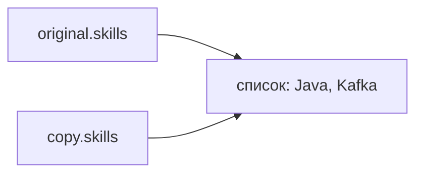
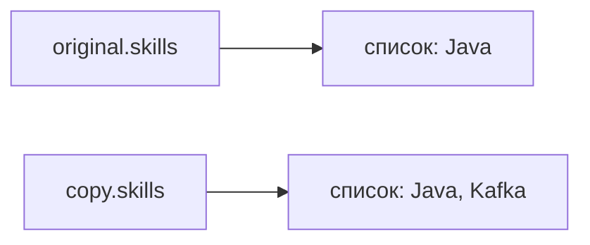

# Класс Object и его методы

`Object` — верхушка дерева наследования в Java. Поскольку Java — объектно-ориентированный язык, внутри core-пакета и не только соблюдаются три столпа: полиморфизм, инкапсуляция и, конечно же, наследование. Вот как раз `Object` существует для соблюдения столпов.

Точнее, двух из них. Как говорит [документация `java.lang.Object`](https://docs.oracle.com/en/java/javase/25/docs/api/java.base/java/lang/Object.html):

> Класс `Object` — корень иерархии классов. У каждого класса `Object` — суперкласс. Все объекты, включая массивы, реализуют методы этого класса.

Класс без `extends` неявно наследуется от `Object` — это [наследование](Наследование.md). А значит, любой объект можно передать туда, где ждут `Object`, — это [полиморфизм](Полиморфизм%20—%20переопределение,%20upcasting%20и%20связывание.md): на нём держится и `equals(Object obj)`, и любой код, которому всё равно, какой объект пришёл. Например, в один `List<Object>` можно сложить объекты никак не связанных классов, любой объект можно вывести в лог через `toString()`, а по полям любого — пройтись рефлексией через `getClass()`. К [инкапсуляции](Инкапсуляция%20и%20модификаторы%20доступа.md) `Object` отношения не имеет.

Как у настоящего класса, у него есть свои методы, а раз так — эти методы есть и у любого объекта в Java. Список методов:

1. `toString()`
2. `equals(Object obj)`
3. `hashCode()`
4. `getClass()`
5. `clone()`
6. `wait()`
7. `wait(long timeout)`
8. `wait(long timeout, int nanos)`
9. `notify()`
10. `notifyAll()`
11. `finalize()`

Удобно разложить их в голове на четыре группы — так делает [Сергей Архипов в разборе вопросов на собеседование](https://www.youtube.com/watch?v=gmS0aaqgOXQ):

| Группа | Методы | Что с ними делаем |
|---|---|---|
| Часто используемые | `toString()`, `equals()`, `hashCode()` | Переопределяем почти в каждом классе, который хранит данные |
| [Синхронизация потоков](../../05%20Многопоточность%20и%20асинхронность/Синхронизация/Модель%20Producer-Consumer%20—%20wait,%20notify,%20notifyAll.md) | `wait()` и две его перегрузки, `notify()`, `notifyAll()` | Вызываем внутри `synchronized`, в новом коде их заменяет `java.util.concurrent` |
| Информация о классе | `getClass()` | Только вызываем: метод `final` |
| Лучше не использовать | `clone()`, `finalize()` | `clone()` заменяем конструктором копирования, `finalize()` — [`try-with-resources`](../Исключения/Обработка%20исключений%20—%20try-catch-finally,%20throw,%20throws.md) |

До нас дожили все 11, но `finalize()` доживает последние релизы. Метод был сначала помечен как `deprecated` в Java 9, затем — `deprecated for removal` в Java 18 ([JEP 421](https://openjdk.org/jeps/421)). При этом в актуальной LTS-версии (Java 25) он **всё ещё есть** в [исходном коде класса `Object`](https://github.com/openjdk/jdk/blob/jdk-25-ga/src/java.base/share/classes/java/lang/Object.java#L608) — пустой и помеченный на удаление:

```java
@Deprecated(since="9", forRemoval=true)
protected void finalize() throws Throwable { }
```

Удалить его могут в любом следующем релизе, а [JVM](../../04%20JVM%20и%20производительность/Архитектура%20JVM/JVM,%20JDK,%20JRE%20и%20байт-код.md), запущенная с флагом `--finalization=disabled`, уже сейчас не вызывает ни одного финализатора.

Теперь подробно про каждый.

## `toString()`

```java
public String toString() {
    return getClass().getName() + "@" + Integer.toHexString(hashCode());
}
```

Имя класса, `@` и хеш объекта в шестнадцатеричном виде. Почему там именно хеш и что будет после переопределения `hashCode()` — разобрано в [статье про `equals()` и `hashCode()`](Контракт%20equals%20и%20hashCode.md#хеш-в-tostring).

Переопределяем, когда хотим видеть в логах содержимое объекта, а не хеш:

```java
@Override
public String toString() {
    return "Programmer{salary=" + salary + ", position=" + position + "}";
}
```

[`record`](../Новые%20версии%20Java/Records.md) генерирует похожий `toString()` сам — по всем компонентам.

## `equals()`

```java
public boolean equals(Object obj) {
    return (this == obj);
}
```

Есть [статья про `equals()`](Контракт%20equals%20и%20hashCode.md#сравнение-по-ссылке-equals-по-умолчанию), где можно прочитать подробнее. Но если кратко, то это обёртка над оператором `==`.

## `hashCode()`

```java
@IntrinsicCandidate
public native int hashCode();
```

А вот здесь тела нет вовсе. `native` значит, что метод реализован не на Java, а на C++ внутри самой JVM, поэтому в IDEA в него и не провалиться. Обычным Java-кодом его не написать: хеш хранится в [заголовке объекта](../../04%20JVM%20и%20производительность/Память%20JVM%20и%20сборка%20мусора/Создание%20объекта%20в%20JVM.md), а до заголовка из Java не дотянуться.

Таких методов в `Object` шесть: `getClass()`, `hashCode()`, `clone()`, `notify()`, `notifyAll()` и приватный `wait0()`, через который работают все три `wait()`. Все они делают то, чего на Java не сделать: узнают настоящий класс объекта, лезут в его заголовок, копируют память, работают с монитором.

Аннотация `@IntrinsicCandidate` — подсказка, что HotSpot может подменить метод заранее написанным машинным кодом, [*интринсиком*](../../04%20JVM%20и%20производительность/JIT%20и%20компиляция/Как%20JVM%20исполняет%20код%20—%20байткод,%20интерпретатор,%20профиль.md). Её ставят не только на `native`-методы: в `Object` она висит даже на пустом конструкторе.

Что именно `hashCode()` делает внутри, откуда берётся число и почему это не адрес в памяти — разобрано в [статье про `equals()` и `hashCode()`](Контракт%20equals%20и%20hashCode.md#native-тела-на-java-нет).

## `getClass()`

```java
@IntrinsicCandidate
public final native Class<?> getClass();
```

Возвращает *класс времени выполнения* — тот, что был указан при `new`, а не тот, что написан у переменной:

```java
Object o = "строка";
System.out.println(o.getClass());                         // class java.lang.String
```

Метод `final`, поэтому переопределить его нельзя, и `native`: JVM просто смотрит в заголовок объекта, где лежит ссылка на его класс. Отсюда и фокус из [статьи про `equals()`](Контракт%20equals%20и%20hashCode.md#наследование-вызываем-superequals): `getClass()`, вызванный в коде родителя, всё равно возвращает класс наследника, потому что смотрит на объект, а не на код.

Интересно, что тип результата хитрее, чем `Class<?>` в сигнатуре. Как говорит [документация](https://docs.oracle.com/en/java/javase/25/docs/api/java.base/java/lang/Object.html#getClass()):

> На самом деле тип результата — `Class<? extends |X|>`, где `|X|` — [стирание](../Generics/Стирание%20типов%20и%20ограничения%20generics.md) статического типа выражения, на котором вызван `getClass`. Например, в этом фрагменте приведение не нужно:

```java
Number n = 0;
Class<? extends Number> c = n.getClass();                 // каст не нужен
System.out.println(c.getSimpleName());                    // Integer
```

То есть компилятор знает: раз переменная типа `Number`, то и класс — какой-то наследник `Number`.

От литерала `.class` метод отличается тем, когда известен ответ. `String.class` пишется у типа и известен уже при компиляции, а `getClass()` вызывается у объекта во время работы программы. Объект `Class` при этом на каждый класс один:

```java
System.out.println(String.class == "java".getClass());    // true — это один и тот же объект
```

Пригождается `getClass()` в трёх местах: строгая проверка класса в `equals()`, имя класса в `toString()` и вход в [рефлексию](../Аннотации%20и%20рефлексия/Рефлексия%20и%20класс%20Class.md): от объекта `Class` можно получить поля, методы и конструкторы. А ещё именно этот объект `Class` захватывают `static synchronized`-методы — к этому вернёмся в разделе про монитор.

## `clone()`

```java
@IntrinsicCandidate
protected native Object clone() throws CloneNotSupportedException;
```

Создаёт копию объекта. Просто так его не вызвать: метод `protected` и бросает [проверяемое исключение](../Исключения/Иерархия%20исключений%20—%20checked%20и%20unchecked.md). Чтобы клонирование заработало, класс должен:

1. реализовать интерфейс `Cloneable`;
2. переопределить `clone()` как `public` и внутри вызвать `super.clone()`.

### `Cloneable`: интерфейс без единого метода

`Cloneable` — *интерфейс-маркер*: в нём нет ни одного метода, он просто помечает класс. И вот что странно: метода `clone()` в нём тоже нет, он живёт в `Object`, а интерфейс только разрешает ему работать. Как говорит [документация `Cloneable`](https://docs.oracle.com/en/java/javase/25/docs/api/java.base/java/lang/Cloneable.html):

> Класс реализует интерфейс `Cloneable`, чтобы показать методу `Object.clone()`, что ему разрешено копировать экземпляры этого класса поле за полем. Вызов метода `clone` класса `Object` у экземпляра, который не реализует `Cloneable`, приводит к исключению `CloneNotSupportedException`.

Сам `Object` `Cloneable` не реализует, так что `new Object().clone()` упадёт с этим исключением, если бы мы вообще смогли его вызвать. Переопределяют `clone()` так:

```java
class Programmer implements Cloneable {
    String name;
    List<String> skills = new ArrayList<>();

    Programmer(String name) {
        this.name = name;
    }

    @Override
    public Programmer clone() {                    // public и сразу Programmer, а не Object
        try {
            return (Programmer) super.clone();     // копию создаёт Object.clone()
        } catch (CloneNotSupportedException e) {
            // Cloneable мы реализовали, так что сюда не попадём никогда
            throw new AssertionError(e);
        }
    }
}
```

Возвращаемый тип можно сузить с `Object` до `Programmer` — это *ковариантный тип возврата*, и снаружи не нужен каст.

### Копия поверхностная

[Дока](https://docs.oracle.com/en/java/javase/25/docs/api/java.base/java/lang/Object.html#clone()) говорит, что `Object.clone()` создаёт новый объект того же класса и заполняет его поля значениями полей оригинала, как простым присваиванием, а сами поля не клонирует. То есть копируются ссылки, а не объекты, на которые они указывают:

```java
Programmer original = new Programmer("Вася");
original.skills.add("Java");

Programmer copy = original.clone();
copy.name = "Петя";
copy.skills.add("Kafka");

System.out.println(original.name);                     // Вася
System.out.println(original.skills);                   // [Java, Kafka] — а добавляли в копию
System.out.println(copy.skills == original.skills);    // true — список один на двоих
```

С `name` всё в порядке: мы положили в поле копии новую ссылку, а `String` [неизменяем](Неизменяемые%20объекты.md). А вот `skills` у оригинала и копии — один и тот же список:



Это и есть *поверхностная копия*. *Глубокая* — когда копируются и вложенные изменяемые объекты, и её приходится писать руками:

```java
@Override
public Programmer clone() {
    try {
        Programmer copy = (Programmer) super.clone();
        copy.skills = new ArrayList<>(skills);     // у копии свой список
        return copy;
    } catch (CloneNotSupportedException e) {
        throw new AssertionError(e);
    }
}
```

Теперь у каждого свой список:



У оригинала остался `[Java]`. Но если бы в списке лежали изменяемые объекты, копировать пришлось бы и их: глубина копии ровно такая, какую мы написали сами.

### Массивы клонируются нормально

У [массивов](../Массивы/Массивы%20в%20Java.md) `clone()` публичный, без проверяемого исключения и сразу возвращает нужный тип — так сказано в [спецификации языка, §10.7](https://docs.oracle.com/javase/specs/jls/se25/html/jls-10.html#jls-10.7). Копия тоже поверхностная:

```java
int[] numbers = {1, 2, 3};
int[] numbersCopy = numbers.clone();               // каст не нужен: вернётся int[]
numbersCopy[0] = 100;
System.out.println(numbers[0]);                    // 1 — у примитивов копируются сами значения

Programmer[] team = { new Programmer("Вася") };
Programmer[] teamCopy = team.clone();
System.out.println(teamCopy[0] == team[0]);        // true — массив новый, программисты те же
```

У многомерного массива копируется только верхний уровень, вложенные массивы остаются общими.

### Почему `clone()` считают неудачным

Джошуа Блох разбирает это в [«Effective Java»](https://www.oreilly.com/library/view/effective-java-3rd/9780134686097/), статья 13. Коротко:

* **`Cloneable` не содержит `clone()`.** Интерфейс есть, а метода в нём нет: имея переменную типа `Cloneable`, клон не вызвать.
* **Объект создаётся в обход [конструктора](Классы,%20объекты%20и%20конструкторы.md).** В примере выше конструктор `Programmer` вызвался один раз, хотя объектов стало два. Всё, что конструктор проверяет или настраивает, копия пропускает.
* **По умолчанию копия поверхностная.** Забыли скопировать одно изменяемое поле — и два объекта молча делят одно состояние, как список выше.
* **Не дружит с `final`-полями.** Глубокая копия переприсваивает поле после `super.clone()`, а `final`-поле переприсвоить нельзя. Будь `skills` `final`, наш второй `clone()` не скомпилировался бы.
* **Каждый класс в иерархии должен участвовать.** `super.clone()` работает как надо, только если все родители тоже правильно реализовали `clone()`.

Поэтому Блох советует копировать конструктором или фабрикой, а `clone()` оставить массивам.

### Чем заменить

| Способ | Как выглядит | Глубина копии | Цена |
|---|---|---|---|
| Конструктор копирования | `new Programmer(other)` | Какую напишем | Писать руками, зато работает с `final` |
| Фабрика копирования | `Programmer.copyOf(other)` | Какую напишем | То же, плюс можно вернуть наследника или кэш |
| [Сериализация](../Сериализация%20объектов/Сериализация%20и%20десериализация%20объектов.md) | Записать объект в байты и прочитать обратно | Полная | Медленно, весь граф должен быть `Serializable` |
| [Неизменяемый объект](Неизменяемые%20объекты.md) | `record` или класс с `final`-полями | Копия не нужна | Каждое изменение — новый объект |

Конструктор копирования выглядит так:

```java
Programmer(Programmer other) {
    this.name = other.name;
    this.skills = new ArrayList<>(other.skills);   // глубина — ровно та, что нам нужна
}
```

На копировании образца построен и паттерн [«Прототип»](../../11%20Архитектура%20и%20проектирование%20ПО/Паттерны%20проектирования/Прототип%20(Prototype).md), но и там `clone()` можно заменить таким конструктором.

## `wait()` и его перегрузки

Чтобы понять `wait()` и `notify()`, сначала нужно понять, что такое *монитор*. Как говорит [спецификация языка, §17.1](https://docs.oracle.com/javase/specs/jls/se25/html/jls-17.html#jls-17.1):

> Каждый объект в Java связан с монитором, который поток может захватить или освободить. Одновременно держать монитор может только один поток. Остальные потоки, которые пытаются его захватить, блокируются, пока не смогут его получить.

Захватывает монитор `synchronized`: блок `synchronized (obj)` — монитор `obj`, обычный `synchronized`-метод — монитор `this`, `static synchronized`-метод — монитор того самого объекта `Class`.

Монитор — как переговорка с одним ключом. Поток, который вошёл в `synchronized`, взял ключ, остальные стоят в очереди у двери. А у переговорки есть ещё комната ожидания — *wait set*. Если потоку внутри не хватает чего-то, чтобы продолжить (например, данных ещё нет), он вызывает `wait()`: отдаёт ключ и уходит в комнату ожидания. Другой поток берёт ключ, делает своё дело и вызывает `notify()`: один ждущий выходит из комнаты ожидания, но войти сможет, только когда ключ освободится.

Монитор — тема большая: блокировки, их состояния в HotSpot, [видимость изменений между потоками](../../05%20Многопоточность%20и%20асинхронность/Модель%20памяти%20Java%20(JMM)/Java%20Memory%20Model%20—%20happens-before,%20видимость,%20переупорядочивание.md). Подробно она разобрана в теме [«Синхронизация: монитор, race condition и deadlock»](../../05%20Многопоточность%20и%20асинхронность/Синхронизация/Синхронизация%20—%20монитор,%20race%20condition%20и%20deadlock.md), а здесь — ровно столько, сколько нужно, чтобы понять методы `Object`.

Из этого и правила, которые [документация](https://docs.oracle.com/en/java/javase/25/docs/api/java.base/java/lang/Object.html#wait(long,int)) расписывает для всех трёх `wait()`:

* **Вызывать только внутри `synchronized` на этом же объекте.** Нет ключа — нечего отдавать:

  ```java
  Object lock = new Object();
  lock.wait();    // IllegalMonitorStateException: current thread is not owner
  ```

* **Отдаётся монитор только этого объекта.** Если поток держал ещё чьи-то мониторы, они остаются занятыми, пока он ждёт.
* **Проснувшись, поток сначала снова захватывает монитор**, и только потом `wait()` возвращает управление.
* **Условие проверяют в цикле `while`, а не в `if`.** Поток может проснуться без `notify()` — это *ложное пробуждение* (spurious wakeup), а пока он снова захватывал монитор, другой поток мог успеть забрать то, чего он ждал.
* **Если поток [прервали](../../05%20Многопоточность%20и%20асинхронность/Потоки/Жизненный%20цикл%20потока%20и%20методы%20управления.md)**, `wait()` бросает `InterruptedException` — поэтому он и объявлен в сигнатуре.

### Зачем создавать `new Object()`

Отсюда ответ на вопрос, который любят задавать на собесе: можно ли создать экземпляр самого `Object` и зачем он нужен? Можно — класс не абстрактный. И пригождается он как раз ради монитора — как пустой объект-замок:

```java
public class ContactsDatabase {
    private static final Object LOCK = new Object();   // замок, о котором снаружи никто не знает
    private static ContactsDatabase instance;

    public static ContactsDatabase getInstance() {
        synchronized (LOCK) {                          // захватываем монитор LOCK, а не класса
            if (instance == null) {
                instance = new ContactsDatabase();
            }
            return instance;
        }
    }
}
```

Почему не `synchronized (this)` или `static synchronized`? Монитор `this` и монитор объекта `Class` может захватить любой код, у которого есть ссылка на наш объект или класс, — и случайно заблокировать нас. Приватный `LOCK` не захватит никто, кроме нас самих. Блох называет это идиомой приватного объекта-замка (статья 82 [«Effective Java»](https://www.oreilly.com/library/view/effective-java-3rd/9780134686097/)).

### `wait()`

Ждёт, пока не разбудят. В JDK 25 это просто вызов перегрузки с нулём:

```java
public final void wait() throws InterruptedException {
    wait(0L);
}
```

### `wait(long timeoutMillis)`

Ждёт, пока не разбудят, но не дольше `timeoutMillis` миллисекунд. Ноль значит «без ограничения», отрицательное значение — `IllegalArgumentException`. Внутри — вызов приватного `native`-метода `wait0()`, того самого из раздела про `hashCode()`, и отдельная ветка для [виртуальных потоков](../../05%20Многопоточность%20и%20асинхронность/Виртуальные%20потоки%20(Project%20Loom)/Виртуальные%20потоки%20—%20модель%20M%20—N,%20носители,%20монтирование.md).

Кстати, по возврату из `wait(timeout)` не понять, разбудили нас или время вышло. Поэтому условие всё равно проверяют в `while`.

### `wait(long timeoutMillis, int nanos)`

Засада: наносекунды здесь почти для красоты. Вот как метод выглядит в JDK 25:

```java
public final void wait(long timeoutMillis, int nanos) throws InterruptedException {
    if (timeoutMillis < 0) {
        throw new IllegalArgumentException("timeoutMillis value is negative");
    }

    if (nanos < 0 || nanos > 999999) {
        throw new IllegalArgumentException(
                            "nanosecond timeout value out of range");
    }

    if (nanos > 0 && timeoutMillis < Long.MAX_VALUE) {
        timeoutMillis++;
    }

    wait(timeoutMillis);
}
```

Любое количество наносекунд больше нуля просто добавляет одну миллисекунду. `wait(0, 1)` ждёт не одну наносекунду, а около миллисекунды. Точнее миллисекунд метод ждать не умеет.

## `notify()`

```java
@IntrinsicCandidate
public final native void notify();
```

Будит один поток из тех, что ждут на мониторе этого объекта. Какой именно — не определено: [документация](https://docs.oracle.com/en/java/javase/25/docs/api/java.base/java/lang/Object.html#notify()) говорит, что выбор произвольный и остаётся за реализацией. Разбуженный поток не продолжит работу, пока тот, кто вызвал `notify()`, не отпустит монитор, а потом соревнуется за монитор со всеми остальными на общих правах.

Вызывать `notify()` тоже можно только держа монитор — иначе всё то же `IllegalMonitorStateException`.

## `notifyAll()`

```java
@IntrinsicCandidate
public final native void notifyAll();
```

Будит все потоки, которые ждут на мониторе этого объекта. Сразу все они продолжить не смогут: по очереди захватывают монитор, и каждый заново проверяет своё условие в `while`.

Зачем будить всех, если хватило бы одного? Потому что на одном мониторе часто ждут *разного*. Возьмём почтовый ящик на одно письмо: почтальон ждёт, пока ящик освободится, а получатель — пока в нём появится письмо.

```java
class Mailbox {
    private String letter;

    synchronized void put(String newLetter) throws InterruptedException {
        while (letter != null) {
            wait();             // ящик занят: отдаём монитор и ждём, пока письмо заберут
        }
        letter = newLetter;
        notifyAll();            // будим всех: среди ждущих есть получатели
    }

    synchronized String take() throws InterruptedException {
        while (letter == null) {
            wait();             // писем нет: ждём почтальона
        }
        String result = letter;
        letter = null;
        notifyAll();            // ящик освободился: будим почтальонов
        return result;
    }
}
```

С `notify()` вместо `notifyAll()` получатель, забрав письмо, мог бы разбудить другого получателя, а не почтальона. Тот проверит условие, увидит пустой ящик и уснёт снова — сигнал потерян, и все ждут друг друга вечно. Подробно этот сценарий разобран в теме [«Модель Producer-Consumer»](../../05%20Многопоточность%20и%20асинхронность/Синхронизация/Модель%20Producer-Consumer%20—%20wait,%20notify,%20notifyAll.md).

На практике `wait()` и `notify()` руками сейчас почти не пишут: тот же почтовый ящик — это `ArrayBlockingQueue` на одно место из [`java.util.concurrent`](../../05%20Многопоточность%20и%20асинхронность/java.util.concurrent/Синхронизаторы,%20блокирующие%20очереди%20и%20атомарные%20типы.md). Блох в той же [«Effective Java»](https://www.oreilly.com/library/view/effective-java-3rd/9780134686097/), статья 81, советует брать готовые утилиты. А на собесе их спрашивают, чтобы проверить, понимаешь ли ты монитор.

## `finalize()`

```java
@Deprecated(since="9", forRemoval=true)
protected void finalize() throws Throwable { }
```

Задумывался как «деструктор». Как говорит [документация](https://docs.oracle.com/en/java/javase/25/docs/api/java.base/java/lang/Object.html#finalize()), [сборщик мусора](../../04%20JVM%20и%20производительность/Память%20JVM%20и%20сборка%20мусора/Сборка%20мусора%20—%20принципы%20и%20поколения.md) вызывает его у объекта, на который больше нет ссылок, а мы в переопределении закрываем ресурсы — файлы, соединения. В `Object` он пустой.

Почему от него отказываются, [JEP 421](https://openjdk.org/jeps/421) называет четыре причины:

* **Непредсказуемая задержка.** Между моментом, когда объект стал недостижим, и вызовом финализатора может пройти сколько угодно времени, а вызов вообще не гарантирован.
* **Код финализатора может что угодно.** Например, сохранить ссылку на `this` в статическое поле — и «воскресить» объект.
* **Включён всегда.** Финализатор срабатывает для каждого объекта класса, даже если конкретному объекту чистить нечего, и отменить его нельзя.
* **Неизвестно, в каком потоке и в каком порядке** вызовутся финализаторы.

Вдобавок финализатор вызывается не больше одного раза, а исключение из него молча проглатывается. Непредсказуемость легко увидеть самому: в цикле создавать объекты с большим массивом внутри и печатать что-нибудь в `finalize()` — сообщения посыпятся пачками тогда, когда придёт сборщик, а не тогда, когда объект перестал быть нужен.

Чем заменить: ресурс закрываем сами через `try-with-resources` — `close()` вызовется сразу и гарантированно.

```java
try (var in = new FileInputStream("data.txt")) {
    // работаем с файлом
}   // close() вызовется здесь, даже если вылетело исключение
```

Для ресурсов, которые живут слишком долго для одного `try`, с Java 9 есть [`Cleaner`](https://docs.oracle.com/en/java/javase/25/docs/api/java.base/java/lang/ref/Cleaner.html): регистрируем действие очистки, и оно выполнится, когда объект станет недостижим, — без большинства недостатков `finalize()`.

### `final`, `finally` и `finalize()`: похожи только названием

| | Что это | Где пишется | Что делает |
|---|---|---|---|
| `final` | Модификатор | У класса, метода, поля, переменной | Класс нельзя наследовать, метод — переопределять, переменную — переприсвоить |
| `finally` | Блок | После `try` | Выполняется всегда — и после `return`, и после исключения. Не выполнится, только если остановить JVM, например `System.exit()` |
| `finalize()` | Метод `Object` | Переопределяли в своих классах | Сборщик мусора вызывает его перед удалением объекта. Устарел, помечен на удаление |

Про `finally` подробнее — в теме [«Обработка исключений»](../Исключения/Обработка%20исключений%20—%20try-catch-finally,%20throw,%20throws.md).

## Что имеем по итогу

`Object` даёт каждому объекту 11 методов, но живут в коде из них по-настоящему три: `toString()`, `equals()` и `hashCode()` — их мы переопределяем постоянно. `getClass()` переопределить нельзя, зато через него начинается рефлексия. `clone()` — неудачный API: копию лучше делать конструктором копирования, а `clone()` оставить массивам. `wait()`, `notify()` и `notifyAll()` — низкоуровневое общение потоков через монитор, в новом коде вместо них `java.util.concurrent`. А `finalize()` доживает последние релизы: ресурсы закрываем через `try-with-resources`.

**Главное для собеса** — про каждый метод уметь объяснить, почему он устроен именно так.

> [!QUESTION]- Проверь себя: вопросы с собеседований, которые закрывает статья
> - `Object` как корень иерархии и группы его методов
> - `toString()` по умолчанию и его переопределение
> - `equals()` и `hashCode()` по умолчанию
> - `getClass()`: класс времени выполнения и отличие от `.class`
> - `clone()`: интерфейс-маркер `Cloneable`, `CloneNotSupportedException`, поверхностная копия
> - Поверхностное и глубокое копирование; почему `clone()` считают неудачным API и чем его заменяют
> - `wait()`, `notify()` и `notifyAll()`: монитор, `IllegalMonitorStateException`, проверка условия в `while`
> - `finalize()`: почему устарел и чем его заменить
> - Чем отличаются `final`, `finally` и `finalize()`

## Ссылки

* [Сергей Архипов, «Java. Класс Object. Разбор вопросов на собеседование»](https://www.youtube.com/watch?v=gmS0aaqgOXQ) — все методы под углом собеса: группы методов, копирование, `wait()` и `notify()`, `finalize()`
* [Документация `java.lang.Object` (Java 25)](https://docs.oracle.com/en/java/javase/25/docs/api/java.base/java/lang/Object.html) — все методы класса и их контракты
* [Исходник `Object.java` в JDK 25](https://github.com/openjdk/jdk/blob/jdk-25-ga/src/java.base/share/classes/java/lang/Object.java) — какие методы `native`, а какие написаны на Java
* [JEP 421: Deprecate Finalization for Removal](https://openjdk.org/jeps/421) — почему финализацию убирают из Java
* [Java Language Specification, §17.1–17.2](https://docs.oracle.com/javase/specs/jls/se25/html/jls-17.html#jls-17.1) — мониторы, wait set и пробуждение потоков
* [Java Language Specification, §10.7](https://docs.oracle.com/javase/specs/jls/se25/html/jls-10.html#jls-10.7) — `clone()` у массивов
* [Документация `Cloneable`](https://docs.oracle.com/en/java/javase/25/docs/api/java.base/java/lang/Cloneable.html) — что на самом деле разрешает интерфейс-маркер
* [Документация `Cleaner`](https://docs.oracle.com/en/java/javase/25/docs/api/java.base/java/lang/ref/Cleaner.html) — замена `finalize()` для долгоживущих ресурсов
* [Джошуа Блох, «Effective Java», 3-е издание](https://www.oreilly.com/library/view/effective-java-3rd/9780134686097/) — статьи 8 (финализаторы), 13 (`clone()`), 81 (`wait()` и `notify()`) и 82 (приватный объект-замок)
