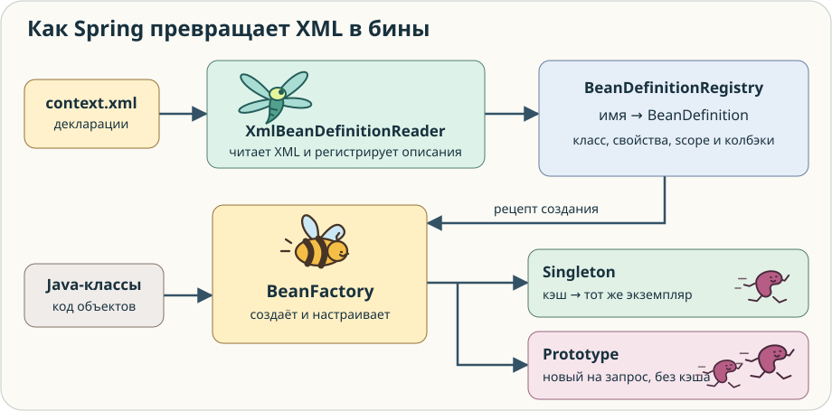

# XML-конфигурация, BeanDefinition и ClassPathXmlApplicationContext

## Объявляем бин в XML

В докладе [«Spring-потрошитель»](https://habr.com/ru/companies/jugru/articles/893638/) первый бин задаётся в XML. В Javadoc дата 26 ноября 2003 года стоит у [`XmlBeanDefinitionReader`](https://docs.spring.io/spring-framework/docs/6.2.11/javadoc-api/org/springframework/beans/factory/xml/XmlBeanDefinitionReader.html), конкретного читателя XML. `BeanDefinitionReader` — интерфейс: из его названия не следует, что источник обязательно XML. И XML, и аннотации по-прежнему можно использовать как источники конфигурации.

Вот XML из [примера доклада](https://www.youtube.com/watch?v=BmBr5diz8WA&t=241s): закрываем `<property>`, дописываем адрес схемы, а неиспользуемый `xmlns:context` убираем. Файл — `src/main/resources/context.xml`.

```xml
<?xml version="1.0" encoding="UTF-8"?>
<beans xmlns="http://www.springframework.org/schema/beans"
       xmlns:xsi="http://www.w3.org/2001/XMLSchema-instance"
       xsi:schemaLocation="http://www.springframework.org/schema/beans
                           https://www.springframework.org/schema/beans/spring-beans.xsd">
    <bean class="quoters.TerminatorQuoter" id="terminatorQuoter">
        <property name="message" value="I'll be back"/>
    </bean>
</beans>
```

`class` говорит, из какого класса создать объект, `id` — под каким именем искать бин. `<property name="message">` работает через [записываемое JavaBeans-свойство](https://docs.spring.io/spring-framework/reference/6.2/core/beans/dependencies/factory-collaborators.html#beans-setter-injection): обычному классу нужен `setMessage(...)`. Одноимённого поля недостаточно, а геттер для записи не нужен. Если параметр должен прийти ещё в конструктор, в XML для этого есть `<constructor-arg>` — это уже другой [способ внедрения](IoC%20и%20DI%20—%20понятия%20и%20типы%20внедрения.md).

## От XML до объекта

Стрекоза на схеме — `XmlBeanDefinitionReader`. Она читает XML и передаёт в `BeanDefinitionRegistry` декларации, а не готовые объекты. На [разборе `<bean>` в Spring 6.2.11](https://github.com/spring-projects/spring-framework/blob/v6.2.11/spring-beans/src/main/java/org/springframework/beans/factory/xml/DefaultBeanDefinitionDocumentReader.java#L305-L311) как раз видно: разобрали элемент, зарегистрировали определение.

[`BeanDefinition`](https://docs.spring.io/spring-framework/docs/6.2.11/javadoc-api/org/springframework/beans/factory/config/BeanDefinition.html) — *метаданные бина*, то есть рецепт его создания и настройки. В нашем случае там имя класса и значение для свойства `message`. В общем случае ещё могут быть аргументы конструктора, ссылки на другие бины, область видимости, признак ленивой инициализации, имена методов инициализации и уничтожения и данные о фабричном методе. Имя `terminatorQuoter` здесь — ключ регистрации, под которым лежит определение.

Пчела — `BeanFactory`: она по рецепту создаёт и настраивает объект. В этом примере один `DefaultListableBeanFactory` выполняет обе роли: он и регистрирует определения, и выдаёт готовые бины. Но внутри это два разных хранилища: [`beanDefinitionMap`](https://github.com/spring-projects/spring-framework/blob/v6.2.11/spring-beans/src/main/java/org/springframework/beans/factory/support/DefaultListableBeanFactory.java#L195) содержит описания по именам, а [`singletonObjects`](https://github.com/spring-projects/spring-framework/blob/v6.2.11/spring-beans/src/main/java/org/springframework/beans/factory/support/DefaultSingletonBeanRegistry.java#L85) — экземпляры синглтонов. Рецепт прототипа хранится, даже когда готовый экземпляр не кэшируется. Что именно происходит с экземплярами, разобрано в [жизненном цикле бина](Жизненный%20цикл%20бина%20и%20scope.md).



## Два способа загрузить тот же файл

Если хотим сами указать ридеру путь, вызываем [`loadBeanDefinitions(Resource)`](https://docs.spring.io/spring-framework/docs/6.2.11/javadoc-api/org/springframework/beans/factory/xml/XmlBeanDefinitionReader.html#loadBeanDefinitions(org.springframework.core.io.Resource)). Передаём `ClassPathResource` — файл из classpath. После загрузки можно отдельно посмотреть на рецепт и только потом запросить экземпляр.

Обычно ридера руками мы не создаём. Передаём путь в конструктор `ClassPathXmlApplicationContext`: он сам вызывает [`refresh()`](https://github.com/spring-projects/spring-framework/blob/v6.2.11/spring-context/src/main/java/org/springframework/context/support/ClassPathXmlApplicationContext.java#L138-L145), а в процессе обновления [`AbstractXmlApplicationContext` создаёт ридер и загружает конфигурацию](https://github.com/spring-projects/spring-framework/blob/v6.2.11/spring-context/src/main/java/org/springframework/context/support/AbstractXmlApplicationContext.java#L82-L96). То есть путь всё равно задаём мы, просто не носим его до ридера сами.

Дальше — учебный Java-код для XML выше. Нужны Java 21 и зависимость `org.springframework:spring-context:6.2.11`. В Gradle-проекте с плагином `application` и `mavenCentral()` добавьте `implementation("org.springframework:spring-context:6.2.11")` и укажите `application { mainClass.set("Main") }`. Запуск — задачей `run`.

Файл `src/main/java/quoters/TerminatorQuoter.java`:

```java
package quoters;

public class TerminatorQuoter {
    private String message;

    public void setMessage(String message) {
        this.message = message;
    }

    public void sayQuote() {
        System.out.println(message);
    }
}
```

Файл `src/main/java/Main.java`:

```java
import org.springframework.beans.factory.support.DefaultListableBeanFactory;
import org.springframework.beans.factory.xml.XmlBeanDefinitionReader;
import org.springframework.context.support.ClassPathXmlApplicationContext;
import org.springframework.core.io.ClassPathResource;
import quoters.TerminatorQuoter;

public class Main {
    public static void main(String[] args) {
        var factory = new DefaultListableBeanFactory();
        try {
            var reader = new XmlBeanDefinitionReader(factory);
            reader.loadBeanDefinitions(new ClassPathResource("context.xml"));
            // рецепт уже есть, но простой ридер ещё не создавал объект
            System.out.println(factory.getBeanDefinition("terminatorQuoter").getBeanClassName());
            factory.getBean("terminatorQuoter", TerminatorQuoter.class).sayQuote();
        } finally {
            factory.destroySingletons();
        }

        try (var context = new ClassPathXmlApplicationContext("context.xml")) {
            context.getBean("terminatorQuoter", TerminatorQuoter.class).sayQuote();
        }
    }
}
```

Ожидаемый вывод:

```text
quoters.TerminatorQuoter
I'll be back
I'll be back
```

> [!QUESTION]- Проверь себя
> - Что `XmlBeanDefinitionReader` читает, куда он передаёт результат и что лежит в `BeanDefinition`?
> - За что отвечают `id` и `class` и почему `<property>` требует сеттер?
> - Как передать XML в `ClassPathXmlApplicationContext` и получить бин через `getBean()`?

## Ссылки

* [Евгений Борисов, «Spring-потрошитель»: XML-пример](https://www.youtube.com/watch?v=BmBr5diz8WA&t=241s) и [схема работы фабрики](https://www.youtube.com/watch?v=BmBr5diz8WA&t=374s) — видео доклада.
* [«Spring-потрошитель» в блоге JUG Ru Group](https://habr.com/ru/companies/jugru/articles/893638/) — разделы про XML и устройство фабрики.
* [Javadoc `XmlBeanDefinitionReader`](https://docs.spring.io/spring-framework/docs/6.2.11/javadoc-api/org/springframework/beans/factory/xml/XmlBeanDefinitionReader.html#loadBeanDefinitions(org.springframework.core.io.Resource)) и [`BeanDefinition`](https://docs.spring.io/spring-framework/docs/6.2.11/javadoc-api/org/springframework/beans/factory/config/BeanDefinition.html) — загрузка ресурса и контракт метаданных.
* [Spring Reference: внедрение через сеттеры](https://docs.spring.io/spring-framework/reference/6.2/core/beans/dependencies/factory-collaborators.html#beans-setter-injection) — как связываются `<property>` и метод записи.
* [Регистрация `<bean>`](https://github.com/spring-projects/spring-framework/blob/v6.2.11/spring-beans/src/main/java/org/springframework/beans/factory/xml/DefaultBeanDefinitionDocumentReader.java#L305-L311), [карта определений](https://github.com/spring-projects/spring-framework/blob/v6.2.11/spring-beans/src/main/java/org/springframework/beans/factory/support/DefaultListableBeanFactory.java#L195) и [кэш экземпляров](https://github.com/spring-projects/spring-framework/blob/v6.2.11/spring-beans/src/main/java/org/springframework/beans/factory/support/DefaultSingletonBeanRegistry.java#L85) — исходники Spring 6.2.11.
* [Вызов `refresh()`](https://github.com/spring-projects/spring-framework/blob/v6.2.11/spring-context/src/main/java/org/springframework/context/support/ClassPathXmlApplicationContext.java#L138-L145) и [создание ридера](https://github.com/spring-projects/spring-framework/blob/v6.2.11/spring-context/src/main/java/org/springframework/context/support/AbstractXmlApplicationContext.java#L82-L96) — как контекст загружает XML.

