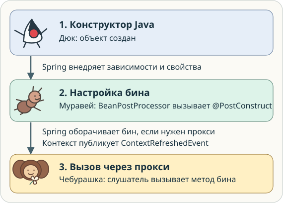

# Трёхфазный конструктор: ContextRefreshedEvent и @PostInitialize

В [«Spring-потрошителе»](https://www.youtube.com/watch?v=BmBr5diz8WA&t=2935s) внезапно начинаются события. До этого мы настраивали отдельный бин: создали `TerminatorQuoter`, положили число в поле с [`@InjectRandomInt`](BeanPostProcessor%20—%20свои%20аннотации%20и%20обработка%20бинов.md), можем уже пользоваться этим числом в `@PostConstruct`. Зачем же теперь слушать целый контекст? Потому что «бин настроен» и «мы можем вызвать его метод через прокси» — два разных момента.

## Откуда взялись события

Вопрос, который у меня возник:

> *События в Spring есть по умолчанию? Как так, я же не строю приложение на событиях?*

Да, у `ApplicationContext` из коробки есть [механизм событий](https://docs.spring.io/spring-framework/reference/core/beans/context-introduction.html#context-functionality-events). И свои события тоже можно отправлять через `ApplicationEventPublisher.publishEvent()`. Это уведомления внутри приложения, по умолчанию синхронные: слушатель выполняется в потоке, который публикует событие. Если в слушателе мы заняты пять секунд, эти пять секунд ждёт и публикующий код. Само по себе это не делает приложение событийно-ориентированным (EDA) и не даёт ни брокера, ни сохранения событий.

| Событие | Когда его публикует контекст |
|---|---|
| `ContextRefreshedEvent` | В конце инициализации или обновления контекста (`refresh()`). Обычные неленивые singleton-бины уже инициализированы. |
| `ContextStartedEvent` | После явного `start()`: сигнал старта для `Lifecycle`-бинов. Это не начало `refresh()`. |
| `ContextStoppedEvent` | После явного `stop()`: сигнал остановки для `Lifecycle`-бинов. Контекст не уничтожен, его можно снова запустить. |
| `ContextClosedEvent` | При закрытии (`close()` или через зарегистрированный shutdown hook), до уничтожения управляемых singleton-бинов. |

В [докладе на 49:17](https://www.youtube.com/watch?v=BmBr5diz8WA&t=2957s) прозвучало, что `ContextStartedEvent` означает начало построения контекста. Здесь оговорка: `start()` вызывают на уже инициализированном контексте. С обычным запуском, когда контекст только создаётся и проходит `refresh()`, связано событие `ContextRefreshedEvent`.

На создание **каждого** бина штатного события контекста нет. Для работы с отдельным бином во время создания у Spring есть колбэки [жизненного цикла](Жизненный%20цикл%20бина%20и%20scope.md), в том числе `BeanPostProcessor`. А вот чтобы дождаться, пока контекст инициализирует обычные singleton-бины, нам подходит `ContextRefreshedEvent`. Регистрируем слушатель как бин, реализуем `ApplicationListener<ContextRefreshedEvent>` — Spring отфильтрует другие события, а в `onApplicationEvent(ContextRefreshedEvent event)` не понадобится `instanceof`.

## Зачем понадобилась третья фаза

Возьмём пример из доклада: `sayQuote()` запускается из `@PostConstruct`, а затем мы вызываем тот же метод на бине из контекста. [Первый вызов не профилируется, второй профилируется](https://www.youtube.com/watch?v=BmBr5diz8WA&t=3133s). Что изменилось? В первый раз Spring вызывает init-метод на целевом объекте. Во второй раз мы уже держим ссылку на [прокси](../АОП/Прокси%20в%20Spring%20—%20JDK%20Dynamic%20Proxy%20и%20CGLIB.md), который успевает замерить время до и после вызова.

С [`@Transactional`](../Spring%20—%20управление%20транзакциями/@Transactional%20в%20Spring%20—%20прокси,%20откат,%20propagation.md) в обычном режиме прокси та же засада. Если поставить аннотацию на сам `@PostConstruct` или вызвать из него свой `this.warmCache()`, этот вызов не пройдёт через транзакционный прокси. Как [говорит документация Spring](https://docs.spring.io/spring-framework/reference/data-access/transaction/declarative/annotations.html), на прокси в init-коде полагаться нельзя. Это не значит, что на этом этапе в приложении вообще нет транзакций: речь об одном конкретном вызове на своём объекте.

У Борисова в коде метка называется [`@PostProxy`](https://www.youtube.com/watch?v=BmBr5diz8WA&t=3172s), а на [итоговом слайде](https://habr.com/ru/companies/jugru/articles/893638/) — `@AfterProxy`. `@PostInitialize` в названии темы — ещё одно имя для такой же **самописной** метки. Ни одной из этих аннотаций Spring сам не обрабатывает. Третью фазу добавляет наш слушатель: по `ContextRefreshedEvent` он находит помеченный метод и вызывает его на объекте, который выдаёт контейнер.

На [итоге доклада](https://www.youtube.com/watch?v=BmBr5diz8WA&t=3822s) помогают запомнить, кто за что отвечает, три персонажа. На схеме заодно видно, где между второй и третьей фазами появляется прокси, если он нужен:



Это схема для обычного singleton-бина, который Spring создаёт при `refresh()`. [Документация Spring](https://docs.spring.io/spring-framework/reference/core/beans/factory-nature.html#beans-factory-lifecycle-initializingbean) советует в `@PostConstruct` проверять внедрённые настройки или собирать локальные структуры данных. Вызов через прокси — отдельная задача. Третья фаза не обещает, что к этому моменту уже созданы все ленивые бины или экземпляры `prototype`.

## Сначала читаем метаданные, потом берём бин

В [докладной реализации](https://www.youtube.com/watch?v=BmBr5diz8WA&t=3326s) слушатель берёт имена локальных определений бинов и читает их через `ConfigurableListableBeanFactory.getBeanDefinition()`. Почему не пройтись по `getBean(name).getClass()`? Во-первых, `getBean()` ради проверки метки может создать ленивый бин. Во-вторых, `getClass()` у выданного объекта может вернуть класс JDK-прокси, а метку мы поставили на метод **реализации**.

Для простого XML-описания с `class` можно взять `getBeanClassName()`, разрешить класс и искать метку на его методах. Но [`getBeanClassName()`](https://docs.spring.io/spring-framework/docs/current/javadoc-api/org/springframework/beans/factory/config/BeanDefinition.html#getBeanClassName()) не обещает тип экземпляра: для определения из `@Bean` там может быть имя класса фабрики либо `null`. И даже объявленный тип результата `@Bean` может быть интерфейсом без метки на методе. Поэтому для такого приёма нужно либо ограничить допустимые определения бинов, либо явно регистрировать методы, которые мы хотим запустить. Вызывать `getBean()` для всех подряд — не решение проблемы с метаданными.

Только когда нашли метку, запрашиваем конкретный бин и подбираем метод для вызова на нём. В докладе слушатель вызывает публичный метод без аргументов, поэтому при своей реализации стоит явно ограничить метку такими методами. [Про `lazy` в докладе есть оговорка](https://www.youtube.com/watch?v=BmBr5diz8WA&t=3839s): если помеченный бин нужно вызвать сейчас, мы тем самым готовы создать его сейчас. Фильтр по метаданным позволяет не создавать остальные бины при переборе. Если ленивость принципиальна, такой бин в запуск по `refresh()` не включаем.

Здесь Борисов [отдельно оговаривает, зачем внедряет фабрику](https://www.youtube.com/watch?v=BmBr5diz8WA&t=3437s). Мы пишем расширение контейнера, а читать его метаданные и есть работа этого слушателя. В `TerminatorQuoter` или в сервисе, который греет кэш, фабрика была бы лишней: нужные бизнес-зависимости лучше передать явно через конструктор, а не прятать их за `getBean()`.

## Найти метод и вызвать метод: две разные операции

Почему нельзя взять [`Method`](../../03%20Java%20Core/Аннотации%20и%20рефлексия/Класс%20Method%20и%20вызов%20методов%20через%20рефлексию.md) от `TerminatorQuoter` и просто сделать `invoke(proxy)`? Дело не в том, что мы нашли класс через `Class.forName()`. По [контракту `Method.invoke()`](https://docs.oracle.com/en/java/javase/25/docs/api/java.base/java/lang/reflect/Method.html#invoke(java.lang.Object,java.lang.Object...) объект для нестатического метода должен быть экземпляром класса или интерфейса, объявившего метод. JDK-прокси реализует `Quoter`, но не наследуется от `TerminatorQuoter`. Совпадение имени и параметров этого не меняет.

Ниже учебный пример, не код из доклада. `@PostInitialize` здесь — наша метка на реализации, а вывод из `InvocationHandler` заменяет настоящее профилирование. Сохраняем блок как `Main.java` в UTF-8, запускаем `java Main.java` на JDK 25 (достаточно JDK 11+ в UTF-8-окружении). Spring, база и дополнительные зависимости не нужны.

```java
import java.lang.annotation.ElementType;
import java.lang.annotation.Retention;
import java.lang.annotation.RetentionPolicy;
import java.lang.annotation.Target;
import java.lang.reflect.InvocationTargetException;
import java.lang.reflect.Method;
import java.lang.reflect.Proxy;

public class Main {
    @Retention(RetentionPolicy.RUNTIME)
    @Target(ElementType.METHOD)
    public @interface PostInitialize {}

    public interface Quoter {
        void sayQuote();
    }

    public static class TerminatorQuoter implements Quoter {
        @Override
        @PostInitialize
        public void sayQuote() {
            System.out.println("I'll be back");
        }
    }

    public static void main(String[] args) throws ReflectiveOperationException {
        Quoter target = new TerminatorQuoter();
        Object bean = Proxy.newProxyInstance(
                Quoter.class.getClassLoader(),
                new Class<?>[] { Quoter.class },
                (proxy, method, arguments) -> {
                    System.out.println("proxy intercepted " + method.getName());
                    try {
                        return method.invoke(target, arguments);
                    } catch (InvocationTargetException e) {
                        throw e.getCause();
                    }
                });

        // метку читаем на реализации.
        Method original = TerminatorQuoter.class.getMethod("sayQuote");
        System.out.println(original.isAnnotationPresent(PostInitialize.class)); // true
        try {
            original.invoke(bean);
            throw new AssertionError("JDK proxy is not a TerminatorQuoter");
        } catch (IllegalArgumentException e) {
            System.out.println("IllegalArgumentException: wrong receiver");
        }

        // для вызова берём Method у класса фактического объекта или у интерфейса.
        Method runtime = bean.getClass().getMethod(original.getName(), original.getParameterTypes());
        Method contract = Quoter.class.getMethod(original.getName(), original.getParameterTypes());
        runtime.invoke(bean);  // proxy intercepted sayQuote, затем I'll be back
        contract.invoke(bean); // то же самое
    }
}
```

[`getMethod()`](https://docs.oracle.com/en/java/javase/25/docs/api/java.base/java/lang/Class.html#getMethod(java.lang.String,java.lang.Class...)) ищет публичный метод по имени и **точным объявленным типам параметров**. В примере список пуст, а для перегрузок он позволяет выбрать нужный метод. Если бы `sayQuote()` был только на реализации и не входил в интерфейс, который реализует [JDK-прокси](https://docs.oracle.com/en/java/javase/25/docs/api/java.base/java/lang/reflect/Proxy.html), `getMethod()` на прокси бросил бы `NoSuchMethodException`. Если интерфейс нам известен, лучше брать метод с него: так мы не зависим от доступности сгенерированного класса прокси. В инфраструктурном коде Spring есть ещё [`AopUtils.selectInvocableMethod()`](https://docs.spring.io/spring-framework/docs/current/javadoc-api/org/springframework/aop/support/AopUtils.html#selectInvocableMethod(java.lang.reflect.Method,java.lang.Class)), чтобы подобрать метод для фактического типа.

С [CGLIB](https://docs.spring.io/spring-framework/reference/core/aop/proxying.html) иначе: прокси — наследник, значит, `original.invoke(bean)` принимает его, а для доступного переопределяемого метода Java выбирает реализацию по фактическому типу объекта. Так вызов может попасть в перехватчик. Но **«рефлексия вызвала метод» не значит «аспект сработал»**. `final` и `private` методы нельзя переопределить для перехвата CGLIB; `private` вдобавок не найдётся через `getMethod()`. И если внутри метода на целевом объекте мы вызываем следующий метод через `this`, этот следующий вызов опять обходит прокси, даже после `refresh()`.

## Что имеем по итогу

Если цель — наполнить БД на старте, не обязательно учить Spring новой аннотации. Делаем бин-слушатель с `@EventListener(ContextRefreshedEvent.class)` и внедряем ему отдельный сервис. Слушатель принимает событие и вызывает, например, `referenceDataService.ensureDefaults()`. На публичном методе сервиса стоит `@Transactional`, в контексте настроено управление транзакциями, а если используется JDK-прокси, метод объявлен в его интерфейсе. Получается внешний вызов через прокси. Самому слушателю для этого прокси не нужен: транзакция открывается на входе в сервис, если её уже нет и используется стандартный `REQUIRED`.

У `ContextRefreshedEvent` нет гарантии «один раз на приложение». Некоторые контексты поддерживают повторный `refresh()`, а в [иерархии контекстов](https://github.com/spring-projects/spring-framework/blob/v7.0.1/spring-context/src/main/java/org/springframework/context/support/AbstractApplicationContext.java#L448) событие дочернего контекста доходит до родителя. Если нужна реакция только на свой контекст, сравниваем `event.getApplicationContext()` с ожидаемым контекстом по ссылке. И сами операции делаем идемпотентными: например, повторное заполнение справочника не должно добавлять дубликаты. Это отдельная гарантия кода и БД, а не свойство события.

> [!QUESTION]- Проверь себя: вопросы с собеседований, которые закрывает статья
> - Как `ContextRefreshedEvent` связан с `refresh()` и чем отличается от `ContextStartedEvent`?
> - Как подписаться только на `ContextRefreshedEvent` через `ApplicationListener`?
> - Почему вызов своего метода из `@PostConstruct` обходит транзакционный прокси и как устроить третью фазу?
> - Зачем искать свою метку по исходному классу и как затем получить метод, который можно вызвать на прокси?
> - Зачем слушателю может понадобиться фабрика бинов и почему бизнес-сервису обычно нет?
> - Как через слушатель и отдельный сервис наполнить БД в транзакции?

## Ссылки

* [Евгений Борисов, «Spring-потрошитель»: события и трёхфазный конструктор](https://www.youtube.com/watch?v=BmBr5diz8WA&t=2935s) — оригинальный доклад, от объяснения слушателя до третьей фазы.
* [JUG Ru Group, «Spring-потрошитель»](https://habr.com/ru/companies/jugru/articles/893638/) — текстовая версия, код `@PostProxy` и итоговый слайд с `@AfterProxy`.
* [Spring Framework: стандартные и пользовательские события](https://docs.spring.io/spring-framework/reference/core/beans/context-introduction.html#context-functionality-events) — события контекста, отбор слушателей и синхронная доставка по умолчанию.
* [Spring Framework: инициализация бинов](https://docs.spring.io/spring-framework/reference/core/beans/factory-nature.html#beans-factory-lifecycle-initializingbean) — что делать в `@PostConstruct` и когда лучше использовать слушатель.
* [Spring Framework: `AbstractApplicationContext.publishEvent()`](https://github.com/spring-projects/spring-framework/blob/v7.0.1/spring-context/src/main/java/org/springframework/context/support/AbstractApplicationContext.java#L448) — передача события родительскому контексту.
* [Spring Framework: `BeanDefinition.getBeanClassName()`](https://docs.spring.io/spring-framework/docs/current/javadoc-api/org/springframework/beans/factory/config/BeanDefinition.html#getBeanClassName()) — почему имя класса определения не всегда означает класс бина.
* [Spring Framework: `@Transactional`](https://docs.spring.io/spring-framework/reference/data-access/transaction/declarative/annotations.html) — режим прокси, видимость методов и ограничение на вызовы из `@PostConstruct`.
* [Spring Framework: механизмы проксирования](https://docs.spring.io/spring-framework/reference/core/aop/proxying.html) — ограничения CGLIB и вызовы через `this`.
* [Spring Framework: `AopUtils.selectInvocableMethod()`](https://docs.spring.io/spring-framework/docs/current/javadoc-api/org/springframework/aop/support/AopUtils.html#selectInvocableMethod(java.lang.reflect.Method,java.lang.Class)) — как выбрать метод, доступный на фактическом типе.
* [Javadoc: `Method.invoke()`](https://docs.oracle.com/en/java/javase/25/docs/api/java.base/java/lang/reflect/Method.html#invoke(java.lang.Object,java.lang.Object...)) и [`Class.getMethod()`](https://docs.oracle.com/en/java/javase/25/docs/api/java.base/java/lang/Class.html#getMethod(java.lang.String,java.lang.Class...)) — условия вызова и поиска метода.
* [Javadoc: `Proxy`](https://docs.oracle.com/en/java/javase/25/docs/api/java.base/java/lang/reflect/Proxy.html) — что объявлено на классе JDK-прокси и какие вызовы попадают в `InvocationHandler`.

