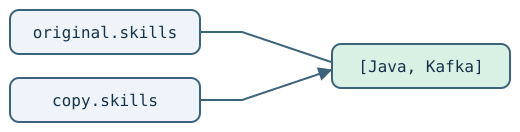
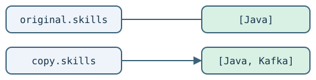

# The Object Class and Its Methods

`Object` sits at the root of Java's inheritance tree. Java is an object-oriented language, and the core library follows the same three pillars as the rest of it: polymorphism, encapsulation, and, of course, inheritance. `Object` is part of how those pillars work.

Two of them, to be precise. As the [`java.lang.Object` documentation](https://docs.oracle.com/en/java/javase/25/docs/api/java.base/java/lang/Object.html) puts it:

> Class `Object` is the root of the class hierarchy. Every class has `Object` as a superclass. All objects, including arrays, implement the methods of this class.

A class declared with `class` and no `extends` clause implicitly extends `Object` (except `Object` itself). That's [inheritance](https://smesitejl.github.io/my-java-knowledge/ru/03%20Java%20Core/ООП/Наследование/) (Russian). And we can pass any object wherever an `Object` is expected. That's [polymorphism](https://smesitejl.github.io/my-java-knowledge/ru/03%20Java%20Core/ООП/Полиморфизм%20—%20переопределение,%20upcasting%20и%20связывание/) (Russian): it's what makes `equals(Object obj)` possible, along with any other code that doesn't care which kind of object it gets. We can put objects of unrelated classes in one `List<Object>`, log any object with `toString()`, or start with `getClass()` and inspect its fields through reflection. `Object` doesn't have anything to do with [encapsulation](https://smesitejl.github.io/my-java-knowledge/ru/03%20Java%20Core/ООП/Инкапсуляция%20и%20модификаторы%20доступа/) (Russian).

Like any class, `Object` has methods of its own. In this case, that means every Java object has them too. Here's the list:

1. `toString()`
2. `equals(Object obj)`
3. `hashCode()`
4. `getClass()`
5. `clone()`
6. `wait()`
7. `wait(long timeout)`
8. `wait(long timeout, int nanos)`
9. `notify()`
10. `notifyAll()`
11. `finalize()`

It's easier to remember them in four groups, as [Sergey Arkhipov does in his interview walkthrough](https://www.youtube.com/watch?v=gmS0aaqgOXQ):

| Group | Methods | What we do with them |
|---|---|---|
| The ones we use all the time | `toString()`, `equals()`, `hashCode()` | Override them in nearly every class that holds data |
| [Thread synchronization](https://smesitejl.github.io/my-java-knowledge/ru/05%20Многопоточность%20и%20асинхронность/Синхронизация/Модель%20Producer-Consumer%20—%20wait,%20notify,%20notifyAll/) (Russian) | `wait()` and its two overloads, `notify()`, `notifyAll()` | Call them from `synchronized` code; in new code, use `java.util.concurrent` instead |
| Class information | `getClass()` | Call it, but don't override it: it's `final` |
| Better left alone | `clone()`, `finalize()` | Replace `clone()` with a copy constructor and `finalize()` with [`try-with-resources`](https://smesitejl.github.io/my-java-knowledge/ru/03%20Java%20Core/Исключения/Обработка%20исключений%20—%20try-catch-finally,%20throw,%20throws/) (Russian) |

All 11 are still with us, but `finalize()` is on its way out. It was deprecated in Java 9, then deprecated for removal in Java 18 ([JEP 421](https://openjdk.org/jeps/421)). In the current LTS release (Java 25), it's **still there** in the [`Object` source code](https://github.com/openjdk/jdk/blob/jdk-25-ga/src/java.base/share/classes/java/lang/Object.java#L608), with an empty body and a mark for removal:

```java
@Deprecated(since="9", forRemoval=true)
protected void finalize() throws Throwable { }
```

It can go away in a future release, and a [JVM](https://smesitejl.github.io/my-java-knowledge/ru/04%20JVM%20и%20производительность/Архитектура%20JVM/JVM,%20JDK,%20JRE%20и%20байт-код/) (Russian) launched with `--finalization=disabled` already runs no finalizers at all.

Now let's take the methods one at a time.

## `toString()`

```java
public String toString() {
    return getClass().getName() + "@" + Integer.toHexString(hashCode());
}
```

The class name, an `@`, and the object's hash code in hex. Why a hash code, and what happens when we override `hashCode()`? That's covered in the [article on `equals()` and `hashCode()`](Контракт%20equals%20и%20hashCode.md#the-hash-in-tostring).

We override it when we want to see what's in the object in our logs, rather than just its hash code:

```java
@Override
public String toString() {
    return "Programmer{salary=" + salary + ", position=" + position + "}";
}
```

A [`record`](https://smesitejl.github.io/my-java-knowledge/ru/03%20Java%20Core/Новые%20версии%20Java/Records/) (Russian) generates a similar `toString()` on its own, using all of its components.

## `equals()`

```java
public boolean equals(Object obj) {
    return (this == obj);
}
```

The [article on `equals()`](Контракт%20equals%20и%20hashCode.md#reference-equality-the-default-equals) goes into more detail. The short version: it's a wrapper around `==`.

## `hashCode()`

```java
@IntrinsicCandidate
public native int hashCode();
```

This one doesn't have a body at all. In HotSpot, `native` means the implementation here is in C++ inside the JVM, not in Java, which is why we can't jump into it in IDEA. We can't implement it in ordinary Java: HotSpot stores the identity hash code in the [object header](https://smesitejl.github.io/my-java-knowledge/ru/04%20JVM%20и%20производительность/Память%20JVM%20и%20сборка%20мусора/Создание%20объекта%20в%20JVM/) (Russian), which Java code doesn't have direct access to.

There are six such methods in `Object`: `getClass()`, `hashCode()`, `clone()`, `notify()`, `notifyAll()`, and the private `wait0()` that all three `wait()` overloads use. They let the JVM do things ordinary Java can't do from scratch: find the object's runtime class, reach into its header, copy its memory, and work directly with its monitor.

`@IntrinsicCandidate` is a hint that HotSpot can give the method special treatment and generate machine code for it directly, using an [*intrinsic*](https://smesitejl.github.io/my-java-knowledge/ru/04%20JVM%20и%20производительность/JIT%20и%20компиляция/Как%20JVM%20исполняет%20код%20—%20байткод,%20интерпретатор,%20профиль/) (Russian). It isn't limited to `native` methods: even the empty `Object` constructor has it.

What does `hashCode()` actually do under the hood? Where does the number come from, and why isn't it a memory address? See the [article on `equals()` and `hashCode()`](Контракт%20equals%20и%20hashCode.md#native-no-java-method-body).

## `getClass()`

```java
@IntrinsicCandidate
public final native Class<?> getClass();
```

It returns the *runtime class*: the class of the object that was created, not the type we wrote next to the variable:

```java
Object o = "строка";
System.out.println(o.getClass());                         // class java.lang.String
```

The method is `final`, so we can't override it, and it's `native`: HotSpot looks at the object header, which points to information about its class. That's why the example in the [article on `equals()`](Контракт%20equals%20и%20hashCode.md#inheritance-calling-superequals) works: `getClass()` called from superclass code still returns the subclass, because it looks at the object, not at the code that's running.

Here's the interesting part: the result type is a little subtler than the `Class<?>` in the signature. As the [documentation](https://docs.oracle.com/en/java/javase/25/docs/api/java.base/java/lang/Object.html#getClass()) says:

> The actual result type is `Class<? extends |X|>` where `|X|` is the [erasure](https://smesitejl.github.io/my-java-knowledge/ru/03%20Java%20Core/Generics/Стирание%20типов%20и%20ограничения%20generics/) (Russian) of the static type of the expression on which `getClass` is called. For example, no cast is required in this code fragment:

```java
Number n = 0;
Class<? extends Number> c = n.getClass();                 // no cast needed
System.out.println(c.getSimpleName());                    // Integer
```

So the compiler knows that because the variable has type `Number`, the runtime class must be `Number` or a subclass of it.

The difference between `getClass()` and a `.class` literal is when we know the answer. `String.class` names a type, so the answer is known at compile time. `getClass()` is called on an object at runtime. Either way, there's one `Class` object for a given class:

```java
System.out.println(String.class == "java".getClass());    // true: it's the same object
```

`getClass()` comes in handy for three things: checking for an exact class match in `equals()`, getting the class name in `toString()`, and getting started with [reflection](https://smesitejl.github.io/my-java-knowledge/ru/03%20Java%20Core/Аннотации%20и%20рефлексия/Рефлексия%20и%20класс%20Class/) (Russian). A `Class` object gives us access to fields, methods, and constructors. It's also the object that `static synchronized` methods lock. We'll come back to that when we get to monitors.

## `clone()`

```java
@IntrinsicCandidate
protected native Object clone() throws CloneNotSupportedException;
```

This makes a copy of an object. We can't just call it from anywhere: the method is `protected` and throws a [checked exception](https://smesitejl.github.io/my-java-knowledge/ru/03%20Java%20Core/Исключения/Иерархия%20исключений%20—%20checked%20и%20unchecked/) (Russian). To use `Object`'s cloning mechanism and expose it to callers, we normally do two things:

1. Implement the `Cloneable` interface.
2. Override `clone()` as `public` and call `super.clone()` inside it.

### `Cloneable`: an interface without a single method

`Cloneable` is a *marker interface*: there isn't a single method in it. It just marks the class. And here's the odd part: `clone()` isn't in the interface either. It lives in `Object`, and the interface just gives it permission to do its job. As the [`Cloneable` documentation](https://docs.oracle.com/en/java/javase/25/docs/api/java.base/java/lang/Cloneable.html) puts it:

> A class implements the `Cloneable` interface to indicate to the `Object.clone()` method that it is legal for that method to make a field-for-field copy of instances of that class. Invoking Object's clone method on an instance that does not implement the `Cloneable` interface results in the exception `CloneNotSupportedException` being thrown.

`Object` itself doesn't implement `Cloneable`, so `new Object().clone()` would throw that exception if we could call it in the first place. Here's how we override `clone()`:

```java
class Programmer implements Cloneable {
    String name;
    List<String> skills = new ArrayList<>();

    Programmer(String name) {
        this.name = name;
    }

    @Override
    public Programmer clone() {                    // public, and returns Programmer instead of Object
        try {
            return (Programmer) super.clone();     // Object.clone() creates the copy
        } catch (CloneNotSupportedException e) {
            // we implement Cloneable, so we'll never get here
            throw new AssertionError(e);
        }
    }
}
```

We can narrow the return type from `Object` to `Programmer`. That's a *covariant return type*, and it means the caller doesn't need a cast.

### The copy is shallow

The [docs](https://docs.oracle.com/en/java/javase/25/docs/api/java.base/java/lang/Object.html#clone()) say that `Object.clone()` creates a new object of the same class and fills in its fields with the original field values, as if by assignment. It doesn't clone the objects those fields refer to. In other words, it copies the references, not the objects they point to:

```java
Programmer original = new Programmer("Вася");
original.skills.add("Java");

Programmer copy = original.clone();
copy.name = "Петя";
copy.skills.add("Kafka");

System.out.println(original.name);                     // Вася
System.out.println(original.skills);                   // [Java, Kafka] — but we added Kafka to the copy
System.out.println(copy.skills == original.skills);    // true: they share one list
```

`name` is fine: we assigned a new reference to the copy's field, and `String` is [immutable](https://smesitejl.github.io/my-java-knowledge/ru/03%20Java%20Core/ООП/Неизменяемые%20объекты/) (Russian). But `skills` is the same list in both the original and the copy:



That's a *shallow copy*. A *deep copy* also copies nested mutable objects, and we have to write that part ourselves:

```java
@Override
public Programmer clone() {
    try {
        Programmer copy = (Programmer) super.clone();
        copy.skills = new ArrayList<>(skills);     // the copy gets its own list
        return copy;
    } catch (CloneNotSupportedException e) {
        throw new AssertionError(e);
    }
}
```

Now each object has its own list:



The original still has `[Java]`. But if the list held mutable objects, we'd have to copy those too. The copy only goes as deep as we make it.

### Arrays clone just fine

For [arrays](https://smesitejl.github.io/my-java-knowledge/ru/03%20Java%20Core/Массивы/Массивы%20в%20Java/) (Russian), `clone()` is `public`, doesn't throw a checked exception, and returns the right type. That's in the [Java Language Specification, §10.7](https://docs.oracle.com/javase/specs/jls/se25/html/jls-10.html#jls-10.7). The copy is still shallow:

```java
int[] numbers = {1, 2, 3};
int[] numbersCopy = numbers.clone();               // no cast needed: this returns int[]
numbersCopy[0] = 100;
System.out.println(numbers[0]);                    // 1: for primitives, the values themselves are copied

Programmer[] team = { new Programmer("Вася") };
Programmer[] teamCopy = team.clone();
System.out.println(teamCopy[0] == team[0]);        // true: new array, same programmers
```

For a multidimensional array, only the top level is copied. The nested arrays are still shared.

### Why `clone()` is a poor API

Joshua Bloch covers this in Item 13 of [*Effective Java*](https://www.oreilly.com/library/view/effective-java-3rd/9780134686097/). The short version:

* **`Cloneable` doesn't declare `clone()`.** We have an interface, but it doesn't have the method. We can't call `clone()` on a variable of type `Cloneable`.
* **It bypasses the [constructor](https://smesitejl.github.io/my-java-knowledge/ru/03%20Java%20Core/ООП/Классы,%20объекты%20и%20конструкторы/) (Russian).** In the example above, the `Programmer` constructor ran once, even though we ended up with two objects. Whatever the constructor checks or sets up, the copy skips it.
* **The default copy is shallow.** Forget to copy one mutable field and the two objects quietly share state, just like the list above.
* **It doesn't play well with `final` fields.** Our deep copy reassigns a field after `super.clone()`, but a `final` field can't be reassigned. If `skills` were `final`, our second `clone()` wouldn't compile.
* **Every class in the hierarchy has to play along.** `super.clone()` only works as intended if all the superclasses implement `clone()` correctly too.

That's why Bloch recommends copying with a constructor or a factory and leaving `clone()` for arrays.

### What to use instead

| Approach | What it looks like | Copy depth | Trade-off |
|---|---|---|---|
| Copy constructor | `new Programmer(other)` | As deep as we make it | We write it ourselves, but it works with `final` |
| Copy factory | `Programmer.copyOf(other)` | As deep as we make it | Same, but it can return a subtype or a cached instance |
| [Serialization](https://smesitejl.github.io/my-java-knowledge/ru/03%20Java%20Core/Сериализация%20объектов/Сериализация%20и%20десериализация%20объектов/) (Russian) | Write the object to bytes, then read it back | Deep for the serialized state | Slow; the entire graph being serialized has to be `Serializable` |
| [Immutable object](https://smesitejl.github.io/my-java-knowledge/ru/03%20Java%20Core/ООП/Неизменяемые%20объекты/) (Russian) | A `record` or a class with `final` fields | No copy needed | Every change means a new object |

Here's what a copy constructor looks like:

```java
Programmer(Programmer other) {
    this.name = other.name;
    this.skills = new ArrayList<>(other.skills);   // copy exactly as deep as we need to
}
```

The [Prototype pattern](https://smesitejl.github.io/my-java-knowledge/ru/11%20Архитектура%20и%20проектирование%20ПО/Паттерны%20проектирования/Прототип%20(Prototype)/) (Russian) is also built around copying a sample object, but we can use a copy constructor instead of `clone()` there too.

## `wait()` and its overloads

To understand `wait()` and `notify()`, we first need to know what a *monitor* is. As the [Java Language Specification, §17.1](https://docs.oracle.com/javase/specs/jls/se25/html/jls-17.html#jls-17.1) puts it:

> Each object in Java is associated with a monitor, which a thread can *lock* or *unlock*. Only one thread at a time may hold a lock on a monitor. Any other threads attempting to lock that monitor are blocked until they can obtain a lock on that monitor.

`synchronized` is how we acquire a monitor. A `synchronized (obj)` block locks `obj`'s monitor, a `synchronized` instance method locks `this`'s monitor, and a `static synchronized` method locks the monitor of that same `Class` object we saw earlier.

A monitor is like a meeting room with a single key. The thread that enters `synchronized` takes the key; the others wait outside the door. The meeting room also has a waiting room, the *wait set*. If the thread inside needs something before it can continue (say, the data isn't ready), it calls `wait()`: it hands back the key and goes to the waiting room. Another thread takes the key, does its work, and calls `notify()`. One thread leaves the waiting room, but it can't get back in until the key is available.

Monitors are a big topic: locks, lock states in HotSpot, and [visibility of changes across threads](https://smesitejl.github.io/my-java-knowledge/ru/05%20Многопоточность%20и%20асинхронность/Модель%20памяти%20Java%20(JMM)/Java%20Memory%20Model%20—%20happens-before,%20видимость,%20переупорядочивание/) (Russian). The topic on [synchronization, monitors, race conditions, and deadlocks](https://smesitejl.github.io/my-java-knowledge/ru/05%20Многопоточность%20и%20асинхронность/Синхронизация/Синхронизация%20—%20монитор,%20race%20condition%20и%20deadlock/) (Russian) goes into detail. Here we only need enough to understand the `Object` methods.

That gives us the rules the [documentation](https://docs.oracle.com/en/java/javase/25/docs/api/java.base/java/lang/Object.html#wait(long,int)) spells out for all three `wait()` overloads:

* **Call it only while holding the monitor of that same object**, through `synchronized`. No key, nothing to hand back:

  ```java
  Object lock = new Object();
  lock.wait();    // IllegalMonitorStateException: current thread is not owner
  ```

* **Only that object's monitor is released.** If the thread holds any other monitors, it keeps them while it waits.
* **When a thread wakes up, it reacquires the monitor first.** Only then does `wait()` return.
* **Check the condition in a `while` loop, not an `if`.** A thread can wake up without a notification, interrupt, or timeout. That's a *spurious wakeup*. Even when notified, it might find that another thread took what it was waiting for while it was reacquiring the monitor.
* **If an [interrupt](https://smesitejl.github.io/my-java-knowledge/ru/05%20Многопоточность%20и%20асинхронность/Потоки/Жизненный%20цикл%20потока%20и%20методы%20управления/) (Russian) ends the wait**, `wait()` throws `InterruptedException`. That's why it's declared in the signature.

### Why create `new Object()`?

That answers an interview favorite: can we create an instance of `Object` itself, and why would we want to? We can: the class isn't abstract. The monitor is exactly what makes the instance useful as an otherwise empty lock object:

```java
public class ContactsDatabase {
    private static final Object LOCK = new Object();   // a lock no outside code knows about
    private static ContactsDatabase instance;

    public static ContactsDatabase getInstance() {
        synchronized (LOCK) {                          // acquire LOCK's monitor, not the class monitor
            if (instance == null) {
                instance = new ContactsDatabase();
            }
            return instance;
        }
    }
}
```

Why not `synchronized (this)` or `static synchronized`? Any code with a reference to our object or its `Class` object can acquire that monitor and accidentally block us. Nobody but us can acquire the monitor on our private `LOCK`. Bloch calls this the private lock object idiom (Item 82 of [*Effective Java*](https://www.oreilly.com/library/view/effective-java-3rd/9780134686097/)).

### `wait()`

Waits without a timeout until the thread wakes up. In JDK 25, it just calls the timed overload with zero:

```java
public final void wait() throws InterruptedException {
    wait(0L);
}
```

### `wait(long timeoutMillis)`

Waits until the thread wakes up or the timeout of `timeoutMillis` milliseconds elapses. The call itself can take longer, since it still has to reacquire the monitor. Zero means no timeout; a negative value gives us an `IllegalArgumentException`. Inside, it calls the private `native` method `wait0()` we saw in the `hashCode()` section, with a separate branch for [virtual threads](https://smesitejl.github.io/my-java-knowledge/ru/05%20Многопоточность%20и%20асинхронность/Виртуальные%20потоки%20(Project%20Loom)/Виртуальные%20потоки%20—%20модель%20M%20—N,%20носители,%20монтирование/) (Russian).

By the way, `wait(timeout)` doesn't tell us whether we were notified or the timeout elapsed. We still have to check the condition in a `while` loop.

### `wait(long timeoutMillis, int nanos)`

Here's the gotcha: the nanoseconds are mostly for show. This is what the method looks like in JDK 25:

```java
public final void wait(long timeoutMillis, int nanos) throws InterruptedException {
    if (timeoutMillis < 0) {
        throw new IllegalArgumentException("timeoutMillis value is negative");
    }

    if (nanos < 0 || nanos > 999999) {
        throw new IllegalArgumentException(
                            "nanosecond timeout value out of range");
    }

    if (nanos > 0 && timeoutMillis < Long.MAX_VALUE) {
        timeoutMillis++;
    }

    wait(timeoutMillis);
}
```

Any valid positive `nanos` adds one millisecond, unless `timeoutMillis` is already `Long.MAX_VALUE`. `wait(0, 1)` sets a timeout of one millisecond, not one nanosecond. This implementation doesn't give us finer than millisecond timeout granularity.

## `notify()`

```java
@IntrinsicCandidate
public final native void notify();
```

Wakes one of the threads waiting on this object's monitor. Which one? The [documentation](https://docs.oracle.com/en/java/javase/25/docs/api/java.base/java/lang/Object.html#notify()) says the choice is arbitrary and left to the implementation. The awakened thread can't continue until the thread that called `notify()` releases the monitor. Then it competes for the monitor alongside everyone else, with no special priority.

We can only call `notify()` while holding the monitor too. Otherwise it's the same `IllegalMonitorStateException`.

## `notifyAll()`

```java
@IntrinsicCandidate
public final native void notifyAll();
```

Wakes all threads waiting on this object's monitor. They can't all resume at once: they acquire the monitor one at a time, and each thread checks its condition again in its `while` loop.

Why wake everyone when one thread would do? Because threads waiting on the same monitor are often waiting for *different things*. Think of a mailbox with room for one letter: the mail carrier waits for the box to be empty, while the recipient waits for a letter to show up.

```java
class Mailbox {
    private String letter;

    synchronized void put(String newLetter) throws InterruptedException {
        while (letter != null) {
            wait();             // the box is full: release the monitor and wait for someone to take the letter
        }
        letter = newLetter;
        notifyAll();            // wake everyone: some of the waiting threads are recipients
    }

    synchronized String take() throws InterruptedException {
        while (letter == null) {
            wait();             // no letters yet: wait for the mail carrier
        }
        String result = letter;
        letter = null;
        notifyAll();            // the box is empty: wake the mail carriers
        return result;
    }
}
```

With `notify()` instead of `notifyAll()`, a recipient who takes a letter might wake another recipient instead of a mail carrier. That recipient checks the condition, sees an empty mailbox, and goes back to sleep. The signal goes to the wrong waiter, and everyone can end up waiting on everyone else forever. The topic on the [producer-consumer model](https://smesitejl.github.io/my-java-knowledge/ru/05%20Многопоточность%20и%20асинхронность/Синхронизация/Модель%20Producer-Consumer%20—%20wait,%20notify,%20notifyAll/) (Russian) walks through this scenario in detail.

In practice, we rarely write `wait()` and `notify()` ourselves anymore. The same mailbox could be an `ArrayBlockingQueue` with a capacity of one, from [`java.util.concurrent`](https://smesitejl.github.io/my-java-knowledge/ru/05%20Многопоточность%20и%20асинхронность/java.util.concurrent/Синхронизаторы,%20блокирующие%20очереди%20и%20атомарные%20типы/) (Russian). In Item 81 of [*Effective Java*](https://www.oreilly.com/library/view/effective-java-3rd/9780134686097/), Bloch recommends using the concurrency utilities that already exist. Interviewers still ask about these methods to see if we understand monitors.

## `finalize()`

```java
@Deprecated(since="9", forRemoval=true)
protected void finalize() throws Throwable { }
```

The idea was to have something like a destructor. As the [documentation](https://docs.oracle.com/en/java/javase/25/docs/api/java.base/java/lang/Object.html#finalize()) explains, when finalization is enabled, the [garbage collector](https://smesitejl.github.io/my-java-knowledge/ru/04%20JVM%20и%20производительность/Память%20JVM%20и%20сборка%20мусора/Сборка%20мусора%20—%20принципы%20и%20поколения/) (Russian) may schedule a finalizer when an object becomes unreachable, but there's no guarantee it will run. In our override, we'd close resources such as files or connections. In `Object` itself, it does nothing.

[JEP 421](https://openjdk.org/jeps/421) gives four reasons finalization is going away:

* **Unpredictable delay.** An arbitrary amount of time can pass between when an object becomes unreachable and when its finalizer runs. In fact, there's no guarantee it'll run at all.
* **A finalizer can do anything.** For example, it can store a reference to `this` in a static field and bring the object back to life.
* **No per-object opt-out.** If a class has a finalizer and finalization is enabled, every instance is eligible for finalization, even if it has nothing to clean up. Since JDK 18, we can disable finalization JVM-wide with `--finalization=disabled`, but we can't turn it off for just one object.
* **The threads and the order are unspecified.** We don't get to decide which threads run the finalizers or in what order.

On top of that, the JVM runs a finalizer at most once per object, and any exception that escapes it is silently swallowed. We can see how unpredictable the timing is by creating objects with a big array inside them in a loop and printing something in `finalize()`. The messages may come in batches when the collector runs. They aren't tied to when we're done with each object, and we might not see them at all.

What to use instead: close the resource ourselves with `try-with-resources`. Its `close()` method is called as soon as we leave the block, even if the code throws:

```java
try (var in = new FileInputStream("data.txt")) {
    // work with the file
}   // close() is called here, even if an exception was thrown
```

For resources that outlive a single `try` block, Java 9 introduced [`Cleaner`](https://docs.oracle.com/en/java/javase/25/docs/api/java.base/java/lang/ref/Cleaner.html). We register a cleanup action that can run automatically after the object becomes phantom reachable, without most of the drawbacks of `finalize()`. That still doesn't give us predictable timing, or even a guarantee it'll run before the JVM exits. We can also trigger the action explicitly with `Cleanable.clean()`.

### `final`, `finally`, and `finalize()`: similar in name only

| | What it is | Where it goes | What it does |
|---|---|---|---|
| `final` | A modifier | On a class, method, field, or variable | A class can't be extended, a method can't be overridden, a variable can't be reassigned |
| `finally` | A block | After `try` (and any `catch` blocks) | Runs when control leaves `try` or `catch`, including on a `return` or an exception. Stopping the JVM with something like `System.exit()` can prevent it from running |
| `finalize()` | An `Object` method | We used to override it in our classes | If finalization is enabled, the JVM may call it before reclaiming the object. Deprecated for removal |

For more on `finally`, see the topic on [exception handling](https://smesitejl.github.io/my-java-knowledge/ru/03%20Java%20Core/Исключения/Обработка%20исключений%20—%20try-catch-finally,%20throw,%20throws/) (Russian).

## What to take away

`Object` gives every object 11 methods, but the three we override all the time are `toString()`, `equals()`, and `hashCode()`. We can't override `getClass()`, but it's our way into reflection. `clone()` is a poor API: use a copy constructor for copies, and leave `clone()` for arrays. `wait()`, `notify()`, and `notifyAll()` are low-level ways for threads to communicate through a monitor; use `java.util.concurrent` in new code. And `finalize()` is on its way out: we close resources with `try-with-resources`.

**The main thing for interviews** is being able to explain why each method works the way it does.

> [!QUESTION]- Check yourself: interview questions this article covers
> - `Object` as the root of the hierarchy and the groups of methods it provides
> - The default `toString()` and how to override it
> - The default `equals()` and `hashCode()`
> - `getClass()`: the runtime class and how it differs from `.class`
> - `clone()`: the `Cloneable` marker interface, `CloneNotSupportedException`, and shallow copies
> - Shallow and deep copies; why `clone()` is a poor API and what to use instead
> - `wait()`, `notify()`, and `notifyAll()`: monitors, `IllegalMonitorStateException`, and checking conditions in a `while` loop
> - `finalize()`: why it's deprecated and what to use instead
> - The difference between `final`, `finally`, and `finalize()`

## References

* [Sergey Arkhipov, “Java: The Object Class. Interview Questions Walkthrough”](https://www.youtube.com/watch?v=gmS0aaqgOXQ) (Russian) — all the methods from an interviewer's perspective: groups of methods, copying, `wait()` and `notify()`, and `finalize()`
* [`java.lang.Object` documentation (Java 25)](https://docs.oracle.com/en/java/javase/25/docs/api/java.base/java/lang/Object.html) — every method and its contract
* [`Object.java` source in JDK 25](https://github.com/openjdk/jdk/blob/jdk-25-ga/src/java.base/share/classes/java/lang/Object.java) — which methods are `native` and which are written in Java
* [JEP 421: Deprecate Finalization for Removal](https://openjdk.org/jeps/421) — why Java is removing finalization
* [Java Language Specification, §17.1–17.2](https://docs.oracle.com/javase/specs/jls/se25/html/jls-17.html#jls-17.1) — monitors, wait sets, and how threads wake up
* [Java Language Specification, §10.7](https://docs.oracle.com/javase/specs/jls/se25/html/jls-10.html#jls-10.7) — `clone()` on arrays
* [`Cloneable` documentation](https://docs.oracle.com/en/java/javase/25/docs/api/java.base/java/lang/Cloneable.html) — what the marker interface actually allows
* [`Cleaner` documentation](https://docs.oracle.com/en/java/javase/25/docs/api/java.base/java/lang/ref/Cleaner.html) — an alternative to `finalize()` for long-lived resources
* [Joshua Bloch, *Effective Java*, 3rd edition](https://www.oreilly.com/library/view/effective-java-3rd/9780134686097/) — Items 8 (finalizers), 13 (`clone()`), 81 (`wait()` and `notify()`), and 82 (the private lock object)
