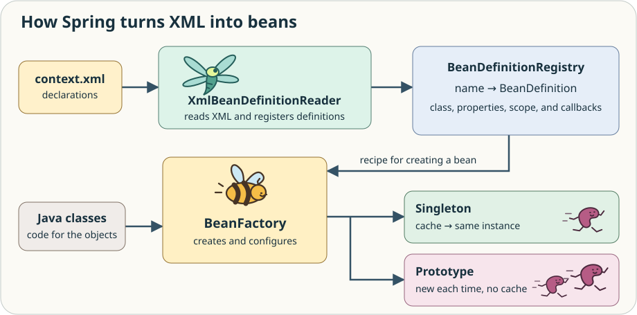

# XML configuration, BeanDefinition, and ClassPathXmlApplicationContext

## Declaring a bean in XML

In the [“Spring the Ripper” talk](https://habr.com/ru/companies/jugru/articles/893638/), the first bean is declared in XML. By the way, that November 26, 2003 date in the Javadoc belongs to [`XmlBeanDefinitionReader`](https://docs.spring.io/spring-framework/docs/6.2.11/javadoc-api/org/springframework/beans/factory/xml/XmlBeanDefinitionReader.html), the reader specifically for XML. The `BeanDefinitionReader` interface itself isn't tied to XML. And we can still describe beans either in XML or with annotations.

Here's the XML from [the talk's example](https://www.youtube.com/watch?v=BmBr5diz8WA&t=241s), with a few fixes: we close `<property>`, add the schema URL, and drop the unused `xmlns:context`. The file is `src/main/resources/context.xml`.

```xml
<?xml version="1.0" encoding="UTF-8"?>
<beans xmlns="http://www.springframework.org/schema/beans"
       xmlns:xsi="http://www.w3.org/2001/XMLSchema-instance"
       xsi:schemaLocation="http://www.springframework.org/schema/beans
                           https://www.springframework.org/schema/beans/spring-beans.xsd">
    <bean class="quoters.TerminatorQuoter" id="terminatorQuoter">
        <property name="message" value="I'll be back"/>
    </bean>
</beans>
```

`class` tells Spring which class to instantiate, and `id` tells us what name to look the bean up by. `<property name="message">` uses a [writable JavaBeans property](https://docs.spring.io/spring-framework/reference/6.2/core/beans/dependencies/factory-collaborators.html#beans-setter-injection): a regular class needs `setMessage(...)`. Having a field with the same name isn't enough, and we don't need a getter to write to it. If a value needs to go into the constructor instead, XML has `<constructor-arg>` for that. That's a different [kind of injection](https://smesitejl.github.io/my-java-knowledge/ru/10%20Spring%20и%20фреймворки/Spring%20Core%20—%20IoC,%20DI%20и%20бины/IoC%20и%20DI%20—%20понятия%20и%20типы%20внедрения/) (Russian).

## From XML to an object

The dragonfly in the diagram is `XmlBeanDefinitionReader`. It reads the XML and hands declarations to `BeanDefinitionRegistry`, not ready-made objects. You can see that in [how Spring 6.2.11 handles `<bean>`](https://github.com/spring-projects/spring-framework/blob/v6.2.11/spring-beans/src/main/java/org/springframework/beans/factory/xml/DefaultBeanDefinitionDocumentReader.java#L305-L311): parse the element, then register the definition.

A [`BeanDefinition`](https://docs.spring.io/spring-framework/docs/6.2.11/javadoc-api/org/springframework/beans/factory/config/BeanDefinition.html) is *bean metadata*: the recipe for creating and configuring the bean. In our case, it has the class name and the value for the `message` property. It can also hold constructor arguments, references to other beans, the scope, a flag for lazy initialization, the names of initialization and destruction methods, and factory method information. Here, `terminatorQuoter` is the key the definition is registered under.

The bee is `BeanFactory`: it follows the recipe to create and configure an object. In this example, one `DefaultListableBeanFactory` does both jobs: it registers definitions and hands out beans. Inside, though, the two are stored separately: [`beanDefinitionMap`](https://github.com/spring-projects/spring-framework/blob/v6.2.11/spring-beans/src/main/java/org/springframework/beans/factory/support/DefaultListableBeanFactory.java#L195) holds definitions by name, while [`singletonObjects`](https://github.com/spring-projects/spring-framework/blob/v6.2.11/spring-beans/src/main/java/org/springframework/beans/factory/support/DefaultSingletonBeanRegistry.java#L85) holds singleton instances. The factory keeps the recipe for a prototype even though it doesn't cache the resulting instance. The [bean lifecycle article](Жизненный%20цикл%20бина%20и%20scope.md) picks up what happens to those instances.



## Two ways to load the same file

If we want to give the reader the path ourselves, we call [`loadBeanDefinitions(Resource)`](https://docs.spring.io/spring-framework/docs/6.2.11/javadoc-api/org/springframework/beans/factory/xml/XmlBeanDefinitionReader.html#loadBeanDefinitions(org.springframework.core.io.Resource)). We pass a `ClassPathResource`, a file on the classpath. Once it's loaded, we can look at the recipe on its own before asking for an instance.

Usually, we don't create the reader ourselves. We pass the path to the `ClassPathXmlApplicationContext` constructor. It calls [`refresh()`](https://github.com/spring-projects/spring-framework/blob/v6.2.11/spring-context/src/main/java/org/springframework/context/support/ClassPathXmlApplicationContext.java#L138-L145), and during the refresh, [`AbstractXmlApplicationContext` creates the reader and loads the XML](https://github.com/spring-projects/spring-framework/blob/v6.2.11/spring-context/src/main/java/org/springframework/context/support/AbstractXmlApplicationContext.java#L82-L96).

Now let's load the same XML both ways. We're using Java 21. In Gradle, with the `application` plugin and the `mavenCentral()` repository, add `implementation("org.springframework:spring-context:6.2.11")` and set `application { mainClass.set("Main") }`. Run the `run` task.

The file `src/main/java/quoters/TerminatorQuoter.java`:

```java
package quoters;

public class TerminatorQuoter {
    private String message;

    public void setMessage(String message) {
        this.message = message;
    }

    public void sayQuote() {
        System.out.println(message);
    }
}
```

The file `src/main/java/Main.java`. Before running it, use the IDE to add the missing imports: four Spring classes and our `TerminatorQuoter` from the `quoters` package.

```java
public class Main {
    public static void main(String[] args) {
        var factory = new DefaultListableBeanFactory();
        try {
            var reader = new XmlBeanDefinitionReader(factory);
            reader.loadBeanDefinitions(new ClassPathResource("context.xml"));
            // we have the recipe, but the reader alone hasn't created the object
            System.out.println(factory.getBeanDefinition("terminatorQuoter").getBeanClassName());
            factory.getBean("terminatorQuoter", TerminatorQuoter.class).sayQuote();
        } finally {
            factory.destroySingletons();
        }

        try (var context = new ClassPathXmlApplicationContext("context.xml")) {
            context.getBean("terminatorQuoter", TerminatorQuoter.class).sayQuote();
        }
    }
}
```

Expected output:

```text
quoters.TerminatorQuoter
I'll be back
I'll be back
```

The first line is the class name we read from the recipe without even calling `getBean()`. The beans themselves print the next two lines: we asked the factory for one and the context for the other.

> [!QUESTION]- Check yourself
> - What does `XmlBeanDefinitionReader` read, where does it send the result, and what's in a `BeanDefinition`?
> - What do `id` and `class` do, and why does `<property>` need a setter?
> - How do we pass XML to `ClassPathXmlApplicationContext` and get a bean with `getBean()`?

## References

* [Eugene Borisov, “Spring the Ripper”: the XML example](https://www.youtube.com/watch?v=BmBr5diz8WA&t=241s) and [the bean factory diagram](https://www.youtube.com/watch?v=BmBr5diz8WA&t=374s) — the talk on video.
* [“Spring the Ripper” on the JUG Ru Group blog](https://habr.com/ru/companies/jugru/articles/893638/) — the sections on XML and how the factory works.
* [Javadoc for `XmlBeanDefinitionReader`](https://docs.spring.io/spring-framework/docs/6.2.11/javadoc-api/org/springframework/beans/factory/xml/XmlBeanDefinitionReader.html#loadBeanDefinitions(org.springframework.core.io.Resource)) and [`BeanDefinition`](https://docs.spring.io/spring-framework/docs/6.2.11/javadoc-api/org/springframework/beans/factory/config/BeanDefinition.html) — how resources are loaded and what the metadata contract says.
* [Spring Reference: Setter-based dependency injection](https://docs.spring.io/spring-framework/reference/6.2/core/beans/dependencies/factory-collaborators.html#beans-setter-injection) — how `<property>` maps to a setter.
* [Registering `<bean>`](https://github.com/spring-projects/spring-framework/blob/v6.2.11/spring-beans/src/main/java/org/springframework/beans/factory/xml/DefaultBeanDefinitionDocumentReader.java#L305-L311), [the definition map](https://github.com/spring-projects/spring-framework/blob/v6.2.11/spring-beans/src/main/java/org/springframework/beans/factory/support/DefaultListableBeanFactory.java#L195), and [the instance cache](https://github.com/spring-projects/spring-framework/blob/v6.2.11/spring-beans/src/main/java/org/springframework/beans/factory/support/DefaultSingletonBeanRegistry.java#L85) — Spring 6.2.11 source code.
* [The `refresh()` call](https://github.com/spring-projects/spring-framework/blob/v6.2.11/spring-context/src/main/java/org/springframework/context/support/ClassPathXmlApplicationContext.java#L138-L145) and [creation of the reader](https://github.com/spring-projects/spring-framework/blob/v6.2.11/spring-context/src/main/java/org/springframework/context/support/AbstractXmlApplicationContext.java#L82-L96) — how the context loads XML.
