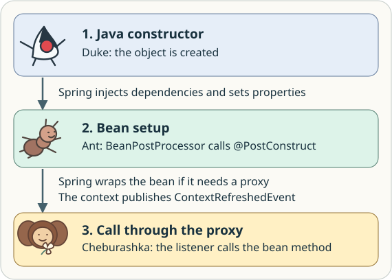

# The three-phase constructor: ContextRefreshedEvent and @PostInitialize

In the [Spring Ripper talk](https://www.youtube.com/watch?v=BmBr5diz8WA&t=2935s), we've already created a `TerminatorQuoter`, put a number in the field marked with [`@InjectRandomInt`](BeanPostProcessor%20—%20свои%20аннотации%20и%20обработка%20бинов.md), and can use that number in `@PostConstruct`. Then events suddenly show up in the talk. Why listen to the whole context if our bean is already set up? Because calling a method on the bean itself and calling it through a proxy are two different things.

## Where the events come from

Here's what I wondered:

> *Does Spring have events by default? How does that work if I'm not building an event-driven application?*

Yes, `ApplicationContext` supports [events](https://docs.spring.io/spring-framework/reference/core/beans/context-introduction.html#context-functionality-events) out of the box. We can publish our own with `ApplicationEventPublisher.publishEvent()`. By default, the listener runs on the same thread: if it takes five seconds, the call to `publishEvent()` waits those same five seconds. These are notifications within the application. There's no broker, event storage, or event-driven architecture out of the box.

| Event | When the context publishes it |
|---|---|
| `ContextRefreshedEvent` | At the end of context initialization or refresh (`refresh()`). Regular non-lazy singleton beans have already been initialized. |
| `ContextStartedEvent` | After an explicit `start()`, which signals `Lifecycle` beans to start. This is not the beginning of `refresh()`. |
| `ContextStoppedEvent` | After an explicit `stop()`, which signals `Lifecycle` beans to stop. The context hasn't been destroyed and can be started again. |
| `ContextClosedEvent` | When the context closes (via `close()` or a registered shutdown hook), before the managed singleton beans are destroyed. |

At [49:17 in the talk](https://www.youtube.com/watch?v=BmBr5diz8WA&t=2957s), `ContextStartedEvent` is described as the beginning of context creation. It's easy to mix these up: we call `start()` on a context that's already been built, while on normal startup we get `ContextRefreshedEvent` at the end of `refresh()`.

Spring doesn't publish an event for the creation of **each** bean. That's what the [bean lifecycle](Жизненный%20цикл%20бина%20и%20scope.md) callbacks, including `BeanPostProcessor`, are for. If we're waiting for the context to finish setting up its regular singleton beans, though, `ContextRefreshedEvent` fits. We register a bean that implements `ApplicationListener<ContextRefreshedEvent>`. Spring filters out the other events for us, so we don't need `instanceof` in `onApplicationEvent(ContextRefreshedEvent event)`.

## Why we need a third phase

Take the example from the talk: `sayQuote()` runs from `@PostConstruct`, and then we call the same method on the bean from the context. [The first call isn't profiled, but the second one is](https://www.youtube.com/watch?v=BmBr5diz8WA&t=3133s). What changed? The first time, Spring calls the init method on the target object. The second time, we're holding a reference to the [proxy](https://smesitejl.github.io/my-java-knowledge/ru/10%20Spring%20и%20фреймворки/АОП/Прокси%20в%20Spring%20—%20JDK%20Dynamic%20Proxy%20и%20CGLIB/) (Russian), which can check the time before and after the call.

With [`@Transactional`](https://smesitejl.github.io/my-java-knowledge/ru/10%20Spring%20и%20фреймворки/Spring%20—%20управление%20транзакциями/@Transactional%20в%20Spring%20—%20прокси,%20откат,%20propagation/) (Russian) in the usual proxy mode, we hit the same snag. Whether we put the annotation on the `@PostConstruct` method itself or call `this.warmCache()` from it, the call won't go through the transaction proxy. As the [Spring docs point out](https://docs.spring.io/spring-framework/reference/data-access/transaction/declarative/annotations.html), we can't rely on the proxy in init code. That doesn't mean there are no transactions anywhere in the application at that point. We're talking about one specific call on our own object.

In Borisov's code the marker is called [`@PostProxy`](https://www.youtube.com/watch?v=BmBr5diz8WA&t=3172s), but on the [final slide](https://habr.com/ru/companies/jugru/articles/893638/) it's `@AfterProxy`. `@PostInitialize` in the title is another name for the same kind of **custom** marker. Spring doesn't handle any of these annotations on its own. Our listener adds the third phase: on `ContextRefreshedEvent`, it finds the marked method and calls it on the object the container gives us.

At the [end of the talk](https://www.youtube.com/watch?v=BmBr5diz8WA&t=3822s), each phase gets its own character. They make it easy to remember where the proxy comes in, if we need one:



The diagram shows a regular singleton that Spring creates during `refresh()`. In `@PostConstruct`, as the [docs suggest](https://docs.spring.io/spring-framework/reference/core/beans/factory-nature.html#beans-factory-lifecycle-initializingbean), we can validate injected configuration or build local data structures. We'll save the call through the proxy for phase three. But not every lazy bean or `prototype` instance has to exist by then.

## Read the metadata first, then get the bean

In the [talk](https://www.youtube.com/watch?v=BmBr5diz8WA&t=3326s), the listener goes through the local bean definition names and reads the definitions with `ConfigurableListableBeanFactory.getBeanDefinition()`. Why not just call `getBean(name).getClass()`? We might create a lazy bean just to check for the marker. And if Spring gives us a JDK proxy, `getClass()` gives us the proxy class even though we put the marker on a method in the **implementation**.

For a simple XML definition with a `class` attribute, we can read `getBeanClassName()`, resolve the class, and look for the marker on its methods. But [`getBeanClassName()`](https://docs.spring.io/spring-framework/docs/current/javadoc-api/org/springframework/beans/factory/config/BeanDefinition.html#getBeanClassName()) doesn't promise to give us the type of the instance: for a definition from `@Bean`, it might give us the factory class name or `null`. And even the declared return type of a `@Bean` method could be an interface with no marker on the method. So if we want to use this approach, we need to either restrict which bean definitions we support or explicitly register the methods we want to run. Calling `getBean()` on everything doesn't solve the metadata problem.

Once we've found the marker, we get the bean itself and look for a method we can call on it. As in the talk, we'll only allow the marker on public methods with no arguments. [The gotcha with `lazy`](https://www.youtube.com/watch?v=BmBr5diz8WA&t=3839s): if we want to call the method now, we have to create the bean now too. We leave the other beans alone because we check the metadata first. If a bean needs to stay lazy, we leave it out of the work triggered by `refresh()`.

Why [inject the factory](https://www.youtube.com/watch?v=BmBr5diz8WA&t=3437s) into the listener? We're extending the container itself, and reading metadata is the listener's job. But `TerminatorQuoter` or a service that warms up the cache has no use for the factory. We'd rather pass their dependencies through the constructor than hide them behind `getBean()`.

## Finding a method and calling it are two different things

Why can't we take the [`Method`](https://smesitejl.github.io/my-java-knowledge/ru/03%20Java%20Core/Аннотации%20и%20рефлексия/Класс%20Method%20и%20вызов%20методов%20через%20рефлексию/) (Russian) from `TerminatorQuoter` and just call `invoke(proxy)`? It has nothing to do with how we found the class through `Class.forName()`. The [`Method.invoke()` contract](https://docs.oracle.com/en/java/javase/25/docs/api/java.base/java/lang/reflect/Method.html#invoke(java.lang.Object,java.lang.Object...)) says that for a non-static method, the receiver must be an instance of the class or interface that declared the method. A JDK proxy implements `Quoter` but doesn't extend `TerminatorQuoter`. Matching names and parameters don't change that.

Let's check this without Spring: we put `@PostInitialize` on the implementation, and instead of profiling the call, we print a message from the `InvocationHandler`. Save the code as `Main.java` in UTF-8, use your IDE's suggestions to add the omitted JDK imports (`Method` and `Proxy` are from `java.lang.reflect`), and run `java Main.java` on JDK 25. JDK 11 or later works in a UTF-8 environment, too. No database or extra dependencies needed.

```java
public class Main {
    @Retention(RetentionPolicy.RUNTIME)
    @Target(ElementType.METHOD)
    public @interface PostInitialize {}

    public interface Quoter {
        void sayQuote();
    }

    public static class TerminatorQuoter implements Quoter {
        @Override
        @PostInitialize
        public void sayQuote() {
            System.out.println("I'll be back");
        }
    }

    public static void main(String[] args) throws ReflectiveOperationException {
        Quoter target = new TerminatorQuoter();
        Object bean = Proxy.newProxyInstance(
                Quoter.class.getClassLoader(),
                new Class<?>[] { Quoter.class },
                (proxy, method, arguments) -> {
                    System.out.println("proxy intercepted " + method.getName());
                    try {
                        return method.invoke(target, arguments);
                    } catch (InvocationTargetException e) {
                        throw e.getCause();
                    }
                });

        // read the marker on the implementation.
        Method original = TerminatorQuoter.class.getMethod("sayQuote");
        System.out.println(original.isAnnotationPresent(PostInitialize.class)); // true
        try {
            original.invoke(bean);
            throw new AssertionError("JDK proxy is not a TerminatorQuoter");
        } catch (IllegalArgumentException e) {
            System.out.println("IllegalArgumentException: wrong receiver");
        }

        // to make the call, get the Method from the actual object's class or from the interface.
        Method runtime = bean.getClass().getMethod(original.getName(), original.getParameterTypes());
        Method contract = Quoter.class.getMethod(original.getName(), original.getParameterTypes());
        runtime.invoke(bean);  // proxy intercepted sayQuote, then I'll be back
        contract.invoke(bean); // same output
    }
}
```

[`getMethod()`](https://docs.oracle.com/en/java/javase/25/docs/api/java.base/java/lang/Class.html#getMethod(java.lang.String,java.lang.Class...)) looks up a public method by name and **exact declared parameter types**. In our example the parameter list is empty. For overloaded methods, the list lets us pick the right one. If `sayQuote()` existed only on the implementation and wasn't on an interface implemented by the [JDK proxy](https://docs.oracle.com/en/java/javase/25/docs/api/java.base/java/lang/reflect/Proxy.html), `getMethod()` on the proxy class would throw `NoSuchMethodException`. If we know the interface, we'd rather get the method from there. This way, we don't depend on the generated proxy class being accessible. Spring's infrastructure code also has [`AopUtils.selectInvocableMethod()`](https://docs.spring.io/spring-framework/docs/current/javadoc-api/org/springframework/aop/support/AopUtils.html#selectInvocableMethod(java.lang.reflect.Method,java.lang.Class)) to pick a method we can call on the actual type.

With [CGLIB](https://docs.spring.io/spring-framework/reference/core/aop/proxying.html), it's different: the proxy is a subclass, so `original.invoke(bean)` accepts it. For an accessible method that can be overridden, Java picks the implementation based on the object's actual type. That means the call can reach the interceptor. But **“reflection called the method” doesn't mean “the aspect ran.”** CGLIB can't override `final` or `private` methods to intercept them, and `getMethod()` won't find a `private` method in the first place. And if a method on the target calls another method through `this`, that second call still bypasses the proxy, even after `refresh()`.

## What we end up with

If the goal is to populate the database on startup, we don't have to teach Spring a new annotation. We make a listener bean with `@EventListener(ContextRefreshedEvent.class)` and inject a separate service into it. The listener gets the event and calls, say, `referenceDataService.ensureDefaults()`. The public service method is marked with `@Transactional`, transaction management is configured in the context, and if we're using a JDK proxy, the method is declared on its interface. That gives us an external call through the proxy. The listener doesn't need a proxy of its own: the transaction starts when we enter the service if there isn't one already and we're using the default `REQUIRED` propagation.

Here's the catch: `ContextRefreshedEvent` can arrive more than once. Some contexts support repeated calls to `refresh()`, and in a [context hierarchy](https://github.com/spring-projects/spring-framework/blob/v7.0.1/spring-context/src/main/java/org/springframework/context/support/AbstractApplicationContext.java#L448), an event from a child context reaches its parent. If we only want events from our own context, we compare that context with `event.getApplicationContext()` by reference. We make the reference data initialization idempotent: calling it again shouldn't create duplicates. That's up to our code and the database, not the event.

> [!QUESTION]- Check yourself: interview questions this article covers
> - How does `ContextRefreshedEvent` relate to `refresh()`, and how is it different from `ContextStartedEvent`?
> - How do we use `ApplicationListener` to subscribe to just `ContextRefreshedEvent`?
> - Why does calling a method on the same bean from `@PostConstruct` bypass the transaction proxy, and how do we add a third phase?
> - Why do we look for our marker on the original class, and how do we then get a method we can call on the proxy?
> - Why might the listener need the bean factory, and why does a business service usually not need it?
> - How do we use a listener and a separate service to populate the database in a transaction?

## References

* [Evgeny Borisov, Spring Ripper: events and the three-phase constructor](https://www.youtube.com/watch?v=BmBr5diz8WA&t=2935s) — the original talk, from the listener explanation through the third phase.
* [JUG Ru Group, Spring Ripper](https://habr.com/ru/companies/jugru/articles/893638/) — the written version, the `@PostProxy` code, and the final slide with `@AfterProxy`.
* [Spring Framework: built-in and custom events](https://docs.spring.io/spring-framework/reference/core/beans/context-introduction.html#context-functionality-events) — context events, listener selection, and synchronous delivery by default.
* [Spring Framework: bean initialization](https://docs.spring.io/spring-framework/reference/core/beans/factory-nature.html#beans-factory-lifecycle-initializingbean) — what to do in `@PostConstruct` and when a listener is a better fit.
* [Spring Framework: `AbstractApplicationContext.publishEvent()`](https://github.com/spring-projects/spring-framework/blob/v7.0.1/spring-context/src/main/java/org/springframework/context/support/AbstractApplicationContext.java#L448) — how an event is passed to the parent context.
* [Spring Framework: `BeanDefinition.getBeanClassName()`](https://docs.spring.io/spring-framework/docs/current/javadoc-api/org/springframework/beans/factory/config/BeanDefinition.html#getBeanClassName()) — why the class name on the definition isn't always the bean's class.
* [Spring Framework: `@Transactional`](https://docs.spring.io/spring-framework/reference/data-access/transaction/declarative/annotations.html) — proxy mode, method visibility, and the limitation on calls from `@PostConstruct`.
* [Spring Framework: proxying mechanisms](https://docs.spring.io/spring-framework/reference/core/aop/proxying.html) — CGLIB limitations and calls through `this`.
* [Spring Framework: `AopUtils.selectInvocableMethod()`](https://docs.spring.io/spring-framework/docs/current/javadoc-api/org/springframework/aop/support/AopUtils.html#selectInvocableMethod(java.lang.reflect.Method,java.lang.Class)) — how to select a method we can call on the actual type.
* [Javadoc: `Method.invoke()`](https://docs.oracle.com/en/java/javase/25/docs/api/java.base/java/lang/reflect/Method.html#invoke(java.lang.Object,java.lang.Object...)) and [`Class.getMethod()`](https://docs.oracle.com/en/java/javase/25/docs/api/java.base/java/lang/Class.html#getMethod(java.lang.String,java.lang.Class...)) — the rules for calling and looking up a method.
* [Javadoc: `Proxy`](https://docs.oracle.com/en/java/javase/25/docs/api/java.base/java/lang/reflect/Proxy.html) — what's declared on a JDK proxy class and which calls go to the `InvocationHandler`.
